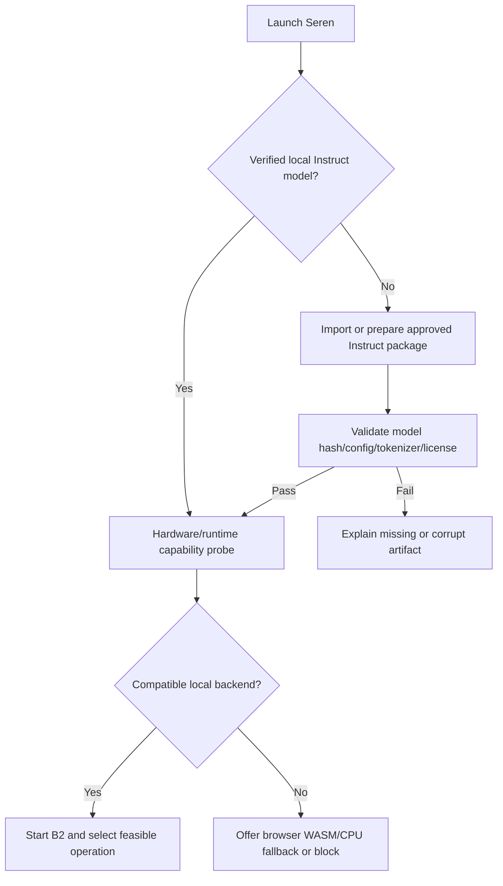

# AppFlow — Seren 7 Local AI Journeys

**ADR-002/ADR-003 active flow:** Every send enters B2 Spiral. It maintains established facts and unresolved residuals, selects a feasible operation through B2 Compass, verifies progress, and chooses a new direction only when productive. The sole language model is Falcon Instruct. The original specialist model routes are historical research, not fallback paths.

**Version:** 1.1 Web-only · **Status:** specified; partially implemented. Current checkpoint evidence: `CHECKPOINT_LOG.md`.

## 1. Global navigation

The product is a **ChatGPT-like browser website**, with no app download/install requirement. Original Seren layout remains: sidebar (new thread, search, working agents, recent threads, theme/account area), top bar (model/style selector, activity badge, copy/share), central greeting/orb or active thread, bottom prompt composer (`Think deeper`, send/stop). On mobile **web browsers**, sidebar becomes a drawer with scrim. The runtime adds only justified status/configuration surfaces.

## 2. First launch and offline provisioning

- A model package can be imported through browser file selection from existing Drive-origin archives or provisioned from user-approved static web assets. Model bytes are verified and saved to browser OPFS where supported. No cloud model lookup during normal offline use and no native installation.
- Show Instruct `missing`, `verifying`, `ready`, `loading`, `loaded`, `failed`, `incompatible` states; report errors rather than hiding them.
- Load the one model only when a language operation needs it. Preflight storage quota and memory policy before import.
- Confirm legal/license acknowledgement and provide clear model data deletion controls.

## 3. Normal chat journey

1. User enters text, presses Enter/send (Shift+Enter adds newline).
2. UI appends a user bubble and immediately persists the pending message.
3. B2 creates a bounded problem state: goal, supplied facts, established derivations, dependencies, unresolved residuals and resource budget.
4. Compass lists feasible local operations and their evidence for goal attraction, expected progress, information gain, cost, error risk and verified reuse. It selects an operation or brakes/clarifies when evidence is insufficient.
5. UI shows authentic operation selection, model loading, calculation, verification or writing status derived from runtime events.
6. If selected, the browser Worker emits Falcon token chunks; calculators and verifiers run locally under bounded contracts. The UI streams readable output without marking unverified text as truth.
7. A verifier adds established facts or identifies a specific residual. B2 may choose a new eligible direction for that residual, preserving all earlier verified work; unchanged residuals brake.
8. On completion, write the answer, actual model/operation IDs, candidate and verifier receipts, unresolved work and finish timestamp transactionally.
9. User may copy, speak (only if a local speech engine exists), regenerate or continue; the thread remains after refresh/restart.

If no model is available, show **Local model not ready** with actionable import/repair state. Never call Claude or return canned suggestion text as if generated by Falcon.

## 4. Direction and operation selection

| Intent | Feasible operation proposal | Verification/fallback |
|---|---|---|
| Everyday conversation | One Instruct language call | Provisional answer; clarify missing facts |
| Exact arithmetic | Approved basic calculator or exact R1 state reuse | Independent check of the requested expression; no model call if unnecessary |
| Logic or multi-step problem | Dependency-ready deterministic operation, then a bounded Instruct hypothesis if needed | Independent constraint check where available; carry unresolved claims forward |
| Coding | Instruct hypothesis | Syntax/functional tests only where a restricted local checker is approved; otherwise provisional |
| Explicit local calculator request | Typed calculator operation or validated Instruct tool proposal | Verify arguments and result; tool receipt does not verify surrounding prose |
| Ambiguous or unsupported task | Clarification, provisional answer or abstention | Conserve budget and expose uncertainty |

Each direction is a hypothesis until measured progress supports it. Only the approved Instruct model may generate language. A missing calculator, verifier, B2CCP or matrix processor is unavailable, not a cue to claim it ran. Record the selected operation, rejected eligible candidates and the reason for fallback. Magnetic direction is software scoring, not a physical effect.

## 5. `Think deeper` journey

The existing toggle alters a **real** local execution budget rather than a remote `modelTier` argument. B2 may investigate dependency-ready residuals, compare bounded feasible operations, ask the same Instruct model for a new hypothesis and run an independent check. A failed node is repaired without discarding established derivations. Expose succinct, actual status (e.g. one calculator result checked) without claiming private chain-of-thought or fabricated progress. If the budget is exhausted, return the best verified partial answer, a clearly provisional answer or an abstention.

## 6. Tool interaction and human approval

1. The same Instruct model may emit a typed proposal `{name, arguments}`; B2 may also choose a deterministic operation directly.
2. Local registry validates exact tool name, argument schema, budget and scope.
3. Read-only deterministic operations can proceed within allowlisted policy.
4. File modifications, external communication, device control, or privacy-sensitive actions require explicit scoped user approval. In a pure offline product, unavailable external actions remain unavailable.
5. Result is independently validated and included in the final answer with appropriate provenance.

No model text is interpreted as a shell command. Tool failure returns a structured residual; B2 can select another feasible direction within budget or abstain. Repeating the same failed proposal is not progress.

## 7. Conversation management

- **New thread:** create stable ID; preserve previous history; reset per-thread context while retaining permitted global competence state.
- **Search:** local-only text search over conversation titles/content; do not prefill fake example threads into user history.
- **Resume:** replay stored user/assistant turns, selected mode and last verified state. Pending interrupted response becomes `interrupted` and may be regenerated.
- **Rename/delete:** update local database; require confirmation for deletion and remove associated local private traces per retention rules.
- **Export:** produce user-requested Markdown/JSON with explicit private data scope.
- **Regenerate:** retain previous assistant version and create a new candidate; don't silently rewrite history.
- **Share/copy:** the existing Share icon currently copies text. Label it `Copy conversation` until true share functionality exists.

## 8. Background agents

Original HTML ships with demonstration entries like fare watch, literature review and memo. In production, no status is displayed unless a genuine local task exists. `Working for you` count derives from running and resumable tasks; task steps are versioned local events. If no real jobs are active, display an intentional empty state instead of `3 agents working`.

## 9. Errors and recovery

| Failure | Required UX |
|---|---|
| Browser has no WebGPU | Try in-browser WASM/CPU if verified, otherwise show unsupported-runtime guidance |
| Falcon-H1 kernel unsupported | Block that path with exact compatibility reason; don't pretend it works |
| Model part/hash wrong | Prevent load, identify missing/corrupt part, offer local replacement |
| Not enough RAM/storage | Stop load safely, unload inactive worker, offer smaller supported quantization |
| Runtime timeout | Retain partial output as unverified; offer retry/change budget |
| User presses Stop | Cancel actual backend request and mark response stopped |
| Browser tab/window closes | Persist safe state; show interrupted run and recovery option on next website visit |
| Tool disallowed | Explain permission/availability and offer non-tool alternative |
| Verification fails | Keep candidate separate, retry appropriate residual or abstain |

## 10. Offline acceptance flow

Open the website via HTTPS/localhost, provision the verified Instruct/runtime assets, chat once, then disable network at OS level and refresh/reopen the same website; reload Instruct, regenerate, run a calculator, search history and export a conversation. Capture a network trace proving zero inference or telemetry egress. A service worker/cache may retain the website shell for offline revisit, **without requiring users to install a PWA**. A previously unvisited remote website cannot load while offline; first-load hosting is an allowed static delivery dependency. Raw `file://` is not the production launch plan.

## 11. UI state machine

`EMPTY` -> `READY` -> `ROUTING` -> `LOADING` (if needed) -> `GENERATING` -> `VERIFYING` -> `COMPLETE`; interruptions: `STOPPED`, `ERROR`, `ABSTAINED`, `OFFLINE_ASSET_MISSING`, `INCOMPATIBLE`. Every transition carries request ID, monotonic sequence, and timestamp, so stale Worker chunks cannot corrupt an active thread.

Acceptance: test every transition under mobile navigation, route switches, browser refresh and model unload/reload.
