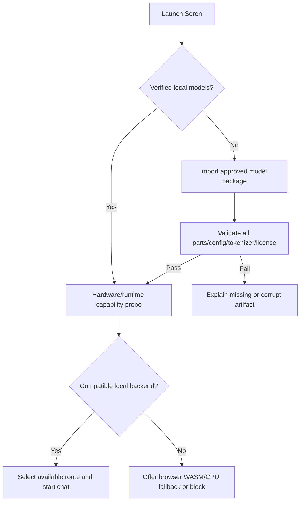

# AppFlow — Seren 7 Local AI Journeys

**Version:** 1.1 Web-only · **Status:** specified; partially implemented. Current checkpoint evidence: `CHECKPOINT_LOG.md`.

## 1. Global navigation

The product is a **ChatGPT-like browser website**, with no app download/install requirement. Original Seren layout remains: sidebar (new thread, search, working agents, recent threads, theme/account area), top bar (model/style selector, activity badge, copy/share), central greeting/orb or active thread, bottom prompt composer (`Think deeper`, send/stop). On mobile **web browsers**, sidebar becomes a drawer with scrim. The runtime adds only justified status/configuration surfaces.

## 2. First launch and offline provisioning

- A model package can be imported through browser file selection from existing Drive-origin archives or provisioned from user-approved static web assets. Model bytes are verified and saved to browser OPFS where supported. No cloud model lookup during normal offline use and no native installation.
- Show per-model `missing`, `verifying`, `ready`, `loading`, `loaded`, `failed`, `incompatible` states; report errors rather than hiding them.
- Do not eagerly load four models on a constrained device. Preflight storage quota and memory policy before import.
- Confirm legal/license acknowledgement and provide clear model data deletion controls.

## 3. Normal chat journey

1. User enters text, presses Enter/send (Shift+Enter adds newline).
2. UI appends a user bubble and immediately persists the pending message.
3. Compass classifies request and selects a specialist or deterministic route from measured competence and active hardware limits.
4. UI shows an authentic `Selecting model`, `Loading`, `Thinking`, `Verifying`, or `Writing` status derived from runtime events.
5. Browser Web Worker emits token chunks; UI streams them progressively while preserving readable Markdown and scroll position.
6. On completion, write assistant response, actual model IDs, route receipts and finish timestamp transactionally.
7. User may copy, speak (only if local speech engine exists), regenerate or continue; thread remains after refresh/restart.

If no model is available, show **Local model not ready** with actionable import/repair state. Never call Claude or return canned suggestion text as if generated by Falcon.

## 4. Specialized routes

| Intent | Initial route proposal | Verification/fallback |
|---|---|---|
| Everyday conversation | Instruct | Format/language check; ask for missing facts |
| Logic or multi-step problem | Compass -> R specialist with bounded Spiral | Deterministic math / contradiction test / abstain |
| Coding | Coder, optional Instruct final explanation | Syntax parser, unit tests where permitted, no execution by default |
| Explicit local calculator request | Tool-Calling to typed calculator | Verify operands/units/result independently |
| Ambiguous task | Instruct clarification or Compass selective exploration | Conserve budget; no unsupported confident assertion |

The route is a hypothesis until each model's competence map validates it. When a specialist is unavailable or times out, an explicit fallback route must be shown and logged; no unseen substitution.

## 5. `Think deeper` journey

The existing toggle alters a **real** local execution budget rather than a remote `modelTier` argument. Compass sets maximum hypothesis count, time/token budget, calculator attempts and verifier requirements. R specialist may decompose, Instruct may communicate findings, and Tool-Calling may propose safe structured operations. Expose succinct status (e.g. 2 alternatives checked) without claiming private chain-of-thought or fabricated progress. If the budget is exhausted, return the best verified partial answer or a clear abstention.

## 6. Tool interaction and human approval

1. Tool-Calling model emits a typed proposal `{name, arguments}`.
2. Local registry validates exact tool name, argument schema, budget and scope.
3. Read-only deterministic operations can proceed within allowlisted policy.
4. File modifications, external communication, device control, or privacy-sensitive actions require explicit scoped user approval. In a pure offline product, unavailable external actions remain unavailable.
5. Result is independently validated and included in the final answer with appropriate provenance.

No model text is interpreted as a shell command. Tool failure returns structured error; Compass can repair once within bounded policy or abstain.

## 7. Conversation management

- **New thread:** create stable ID; preserve previous history; reset per-thread context while retaining permitted global competence state.
- **Search:** local-only text search over conversation titles/content; do not prefill fake example threads into user history.
- **Resume:** replay stored user/assistant turns, selected mode and last verified state. Pending interrupted response becomes `interrupted` and may be regenerated.
- **Rename/delete:** update local database; require confirmation for deletion and remove associated local private traces per retention rules.
- **Export:** produce user-requested Markdown/JSON with explicit private data scope.
- **Regenerate:** retain previous assistant version and create a new candidate; don't silently rewrite history.
- **Share/copy:** the existing Share icon currently copies text. Label it `Copy conversation` until true share functionality exists.

## 8. Background agents

Original HTML ships with demonstration entries like fare watch, literature review and memo. In production, no status is displayed unless a genuine local task exists. `Working for you` count derives from running and resumable tasks; task steps are versioned local events. If no real jobs are active, display an intentional empty state instead of `3 agents working`.

## 9. Errors and recovery

| Failure | Required UX |
|---|---|
| Browser has no WebGPU | Try in-browser WASM/CPU if verified, otherwise show unsupported-runtime guidance |
| Falcon-H1 kernel unsupported | Block that path with exact compatibility reason; don't pretend it works |
| Model part/hash wrong | Prevent load, identify missing/corrupt part, offer local replacement |
| Not enough RAM/storage | Stop load safely, unload inactive worker, offer smaller supported quantization |
| Runtime timeout | Retain partial output as unverified; offer retry/change budget |
| User presses Stop | Cancel actual backend request and mark response stopped |
| Browser tab/window closes | Persist safe state; show interrupted run and recovery option on next website visit |
| Tool disallowed | Explain permission/availability and offer non-tool alternative |
| Verification fails | Keep candidate separate, retry appropriate residual or abstain |

## 10. Offline acceptance flow

Open the website via HTTPS/localhost, provision all model/runtime assets, chat once, then disable network at OS level and refresh/reopen the same website; load another model, regenerate, run a calculator, search history and export a conversation. Capture network trace proving zero inference or telemetry egress. A service worker/cache may be used to retain the website shell for offline revisit, **without requiring users to install a PWA**. A previously unvisited remote website cannot load while offline; first-load hosting is an allowed static delivery dependency. Raw `file://` is not the production launch plan.

## 11. UI state machine

`EMPTY` -> `READY` -> `ROUTING` -> `LOADING` (if needed) -> `GENERATING` -> `VERIFYING` -> `COMPLETE`; interruptions: `STOPPED`, `ERROR`, `ABSTAINED`, `OFFLINE_ASSET_MISSING`, `INCOMPATIBLE`. Every transition carries request ID, monotonic sequence, and timestamp, so stale Worker chunks cannot corrupt an active thread.

Acceptance: test every transition under mobile navigation, route switches, browser refresh and model unload/reload.
