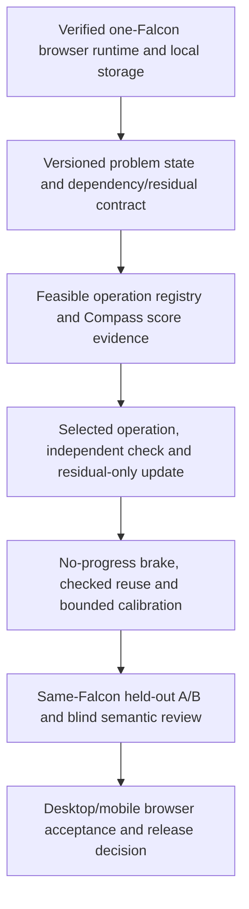

# Plan — Seren 7 Browser-Only B2 Spiral Execution Train

> Current scope/status reconciliation: 2026-11-04. See [SRS.md](SRS.md) §§9–18 and [Seren7_V2_Recovery_Coverage.md](Seren7_V2_Recovery_Coverage.md). Earlier checkpoint sections retain their historical cutoff; they do not override this dated reconciliation.

## CP024 — Patch 2 executable slice and acceptance (proposed, unmerged)

- **P1/P2 bounded slice:** parse 2–6 source-quoted universal-premise edges, record the unknown/dependency graph, execute both forward and backward traversals, and abstain from converse or world-knowledge conclusions. Entrypoint `experimentalChain: true` is opt-in only. Neither full P1 nor P2 is accepted from this narrow grammar.
- **Compass/rotation:** expose `chain_forward` and `chain_backward` as verified-narrow candidates, carry operation receipts and graph states, and rotate on an injected failure; separate checked-outcome profiles can change later selection. This does **not** demonstrate cross-category self-calibration.
- **CP024 gate:** after applying Patch 2, run `npm test` and inspect assertions for default-off, both independent paths, provenance, negative entailment, malformed input, fault rotation and calibration, then `npm run test:browser` on a capable local environment. Audit exact diff, UI parity, no GPU/model loading in deterministic path. Do not promote until these runs and independent unseen trials are recorded.
- **Next:** CP025 non-template semantic interpretation + source-linked multi-hop tasks with real browser interaction; CP026 sealed held-out A/B vs same Falcon and memory/RAM/latency baseline; preserve 14-checkpoint V2 train and release gates.


## 2026-11-03 — Combined P0–P4 and Seren V2 14-checkpoint execution plan (CP023-DOCS)

**Evidence at `d2fd6bc`:** locally authored unseen 4/4 objective outcomes across math/logic/partial code diagnosis and matching browser smoke; separate six-case same-Falcon A/B after corrected scoring showed objective math/logic Falcon-alone 1/3 vs B2 3/3, while code needs human review and planning/conversation outputs were identical. This does not satisfy P4. Frozen 31-case set remains unrun.
**Precedence:** Newest owner V2 instruction proposes Instruct + Coder and TinyLinux tools; V1 single-Instruct remains frozen fallback. CP010–CP022 handoff research is not merged in GitHub main `d2fd6bc`. This is a documentation baseline, not a release acceptance.

| CP | Scope | Evidence status at cutoff | Acceptance/next dependency |
| --- | --- | --- | --- |
| 01 | Preserve original Seren 7 model/UI baseline | Existing V1 tested | git/visual/offline rollback snapshot |
| 02 | Recover MRS/GraphOS/C++/TinyLinux source | Handoff mostly recovered | source hashes/manifests; distinguish missing sources |
| 03 | Replay simulators with independent oracles | Handoff partial | real native/browser result parity plus negative cases |
| 04 | One Falcon on compatible WebGPU | Missing | Falcon-H1 measured true GPU inference/fallback |
| 05 | Two Falcon Instruct/Coder browser workers | Handoff prototype measured; not merged | single/sequential/concurrent real Seren integration |
| 06 | Hardware-aware mode selection | Partial concept | safe measured memory/latency quality routing |
| 07 | L1 deterministic calculators | Bounded verified scopes | broader formal contracts with independent checks |
| 08 | L2 GraphOS/matrix/dependency composition | Handoff experimental | real multi-step request, exact reusable subgraph |
| 09 | L3 Compass/magnetic elastic joints | Partial/experimental | unseen operation-changing path choices, held-out gain |
| 10 | R1 shared-state/version rollback | Bounded verified; broad open | stale-source invalidation and sound equivalence |
| 11 | TinyLinux/WASM Python/C++ tools | Fixed native fixtures; browser lane partial | isolated, killable timeout, permissions, browser-safe fallback |
| 12 | Cortex, residual repair, recursive calibration | Partial, repair failures | full independent model-led repair and cross-domain gains |
| 13 | Lighthouse + P4 independent evaluation | Partial | 7 baselines, blind semantic review, sealed confirmation, device stress |
| 14 | Seren production integration/release | Not approved | complete normal chat path, UX/privacy/security and owner/Shafi sign-off |

**Dependency order:** preserve source and failures → reconcile V1/V2 ADR + typed problem/evidence contracts → opt-in Stage4 GraphOS/Compass/Worker integration → actual path rotation and Cortex checks → safe code/tool lanes → measured dual-Falcon routing → sustained calibration benefits → held-out P1–P4 and Lighthouse acceptance → release approval. Do not rerun successful CP010–CP022 experiments merely to generate another checkpoint; retest only relevant integration/regression boundaries.

**P0–P4 quality gates:** P0 foundation; P1 grounded semantic interpretation must change an executable operation on unseen problems; P2 genuine multidirectional model-led completion/independently verified whole-result residual repair; P3 persisted competence changes later selection with cross-category held-out benefit; P4 independently graded and objective A/B with equal Falcon assets/budgets and meaningful interventions. Eight earlier semantic pairs were identical/non-discriminating; the separate 31-case frozen fixture remains unrun.

**Seven comparison arms:** Instruct alone; Coder alone; historical four-specialist if recovered; V1 single-Falcon Seren; V2 dual Falcon; dual + verified tools; full MRS/B2 GraphOS/Compass/Cortex. Capture accepted-error rate AND coverage, task accuracy, p50/p95 correct latency, real generated TPS, cold/warm model load, RAM, model/tool calls, verified state reuse, source and permission failures. No simulated FLOPS should become a neural inference number.

**Release gates:** original rotating orb/UI and chat CRUD; no remote inference; offline reload; tool sandbox/cancel; correct source/versioned state; physical-phone energy/RAM and multibrowser accessibility; explicit owner approval. No automatic push/deploy.

**Documentation checklist per checkpoint:** PRD, AppFlow, UI_Spec, TRD, Schema, Plan, SRS, architecture traceability, CHECKPOINT_LOG, README, AGENTS and relevant ADR; update only affected meaning, tag implemented versus tested/handoff/proposed, cite versioned receipts and failed experiments.

**2026-11-01 B2 cross-domain checkpoint:** A source-grounded operation contract now reaches existing grouped word math plus bounded contradiction and code-delimiter debugging. The first separately authored local unseen set and real browser smoke checked four objective cases; planning/conversation await human assessment. A real one-model code repair attempt failed single-edit validation. Keep the frozen 31-case fixture untouched. Next: generalize semantic extraction, verify executable code behavior, repeat model-led repair on fresh tasks, then run a controlled same-Falcon A/B comparison with blind subjective review. Do not promote Level 3 from these receipts.

**A/B progress:** A small same-weight, counterbalanced six-case engineering comparison is now recorded. Versioned corrected scoring gave Falcon-alone 1/3 and B2 3/3 for math/logic only; code and two subjective cases per arm remain pending human review. Run a larger independently authored set, establish safe code behavioral checks and obtain blind grades before any promotion.

**Additional regression gate:** A new sparse-profile test starts with five checked successes of the one-operation transfer path and zero measurements for the three-operation alternative; the production Compass must retain the direct path. It passed after extending the existing word-path conservative tie-break to transfers. The prior behavior could have preferred an unmeasured expensive path from a Laplace-smoothed prior; include this test in future controller changes.

**2026-11-01 calibration-evidence checkpoint:** A locally authored 6-case deterministic path training set supplied three independently checked clean runs per path in both grouped-count and transfer grammar; a distinct 4-case later development set evaluated the experimental Compass. First evaluation kept equal accuracy but incorrectly chose higher calculator-call paths on all four later cases due noisy elapsed-time preference; that retained counterexample triggered a cost floor based on path operation count. On rerun, both policies returned four verified exact results and the experimental policy chose no additional calculator calls. This is developer-only, not an untouched external held-out confirmation or measured intelligence gain. Next: browser persistence/smoke, cross-task independent profiles, a model-led repair success, and the frozen confirmation only after preregistered gates.

**2026-11-01 next checkpoint result:** A second bounded semantic relation (named inventory transfer) is now source-grounded and operation-changing; the two executable Level 1/2 paths include direct update and conservation. Six locally authored development cases passed in Node (four exact answers, two appropriate abstentions), with no Falcon calls. Controlled corruption rotates paths. An opt-in Level 3 scoring hypothesis can switch paths from synthetic checked profiles on another question, but this is not training evidence or permission to promote it in the browser. Next gates: real measured independent path profiles, externally prepared unseen cross-category tests, browser/offline regression, generalized semantic graph, then full verified Falcon-led repair. Frozen 31-case fixture stays unrun; do not promote Level 3 from synthetic evidence.

**Mac application addendum:** After the transfer patch was applied to the main checkout, the complete browser suite, offline Falcon smoke, and a focused actual UI transfer test passed locally. The original patch's Node-only evidence remains historical; see the later `CHECKPOINT_LOG.md` receipt. Further independent transfer tasks and measured Level 3 policy outcomes remain open.

**Master mission dependency train (2026-11-01):** Stage A architectural traceability is in `B2_Architecture_Traceability.md`. Stage B begins with the tested goal-progress receipt; next compare actual Compass choices with a direct/static policy on fresh development tasks. Stage C then adds bounded executable candidate paths and Level 2 composition; Level 3 stays in shadow until it beats simpler policies. Stage D makes grounded semantic state change a correct operation on unseen word/code tasks. Stage E requires a fully checked same-Falcon residual-only repair. Stage F tests persisted calibration on unseen outcomes with cost and accuracy; Stage G uses independent objective checks and genuinely discriminating blinded human assessment before running the frozen 31-case confirmation fixture. Each stage requires a browser run, full regressions and a checkpoint receipt; the existing CP001–CP011 historical records remain intact. Current stages B–G are incomplete.

**Next checkpoint slice:** Source-grounded grouped-count interpretation and two alternative executable arithmetic paths now have local and browser confirmation receipts. The first frozen development set failed one plural form before a generic singularization repair; both the failure and same-set rerun remain separate. A fresh local confirmation set passed four supported problems on its first run, while an unknown quantity abstained. After inspecting that receipt, the Compass cost tie-break and graph status bookkeeping were refined; the set is now exposed development evidence for the final source, so a separate untouched external evaluation remains required. Direct/static execution is faster on this narrow set; no Level 3 promotion follows.

**Repair result:** Three new arithmetic-claim explanations triggered incorrect Falcon initial numbers. With Think deeper and an answer-withheld numeric-only correction prompt, all three same-Falcon repairs still failed independent arithmetic checks; verified numeric components were retained and full explanations stayed unverified. This does not satisfy the model-led repair gate. The next attempt should investigate a different narrowly checkable task or model-generation strategy before using the frozen 31-case set.

**Final-source local confirmation:** A second fresh fixture was frozen after the parser/Compass refinements; four new grouped-count questions passed in Node and the actual browser with zero model calls, and one unspecified count remained unparsed. It is locally authored, not externally independent. Direct/static arithmetic remained faster. See the final addendum in `CHECKPOINT_LOG.md` and keep the frozen 31-case evaluation unused.

**2026-11-01 evaluation correction (supersedes the review dependency below):** All eight rendered responses in the prior blinded planning/conversation packet are identical. The raw answers are byte-identical in seven pairs and differ only by trailing whitespace in one. The packet matches the raw receipt; prompt bytes were identical in both arms, and B2 made no semantic intervention. This packet cannot support a between-system human preference. Keep its raw/packet/key unchanged. `tools/b2_complete_eval_v2.mjs` reruns the development fixture with explicit B2 depth, per-generation request IDs and prompt hashes, and excludes identical pairs from its separately versioned review packet. The distinct frozen confirmation fixture stays untouched. Structured Falcon interpretation remains opt-in research after 0/4 live JSON and 0/4 extractive-line success; P1–P4 remain partial.

**ADR-002/ADR-003 active plan:** The user replaced the four-specialist release objective with one Falcon Instruct and a directional B2 Spiral. Existing CP001–CP011 receipts remain historical evidence. The active research gate is to represent problem state, choose evidence-backed operations, retain verified derivations, isolate residuals, redirect bounded work and compare the same Falcon alone versus Falcon+B2 on independent tasks. The initial disjoint objective comparison was 6/18 versus 6/18, with B2 about 7.3% slower. Two later directional sets yielded 4/28 objective passes in aggregate for each arm. A third frozen set showed a narrow Boolean-operation gain, 3/14 versus 1/14, with other objective categories unchanged and no repair. The current candidate adds an explicit dependency graph, verified dependent arithmetic and persisted repair-outcome calibration. A further frozen 31-case run scored 7/23 Falcon-alone versus 13/23 Falcon+B2 on objective checks, with every additional pass from bounded arithmetic/Boolean operations; eight semantic pairs need human grades and no full model-led residual repair occurred. The general reasoning-improvement gate remains open. Physical mobile acceptance remains open without a phone.

The latest P1/P2 continuation adds source-anchored semantic hints and candidate-scoped structural repair checks. A four-case Falcon JSON interpretation probe failed its schema contract in all four cases; hints remain provisional and do not yet route operations. Planning repair produced bounded checked step-count improvements, but no full semantic verification. A new 31-case confirmation fixture is frozen and untouched; its evaluation follows independent grading of the prior eight planning/conversation pairs. P1–P4 therefore remain partial. See `CHECKPOINT_LOG.md` for the false-positive and stale-component corrections.

**Version:** 1.1 Web-only · **Prepared:** 2026-10-26 · **Plan state:** execution underway. Checkpoint headings below are original gates; current statuses and evidence are in `CHECKPOINT_LOG.md`.

## 1. Objective, ownership and guardrails

Deliver a verified **browser-only Seren 7 web application like ChatGPT**, with locally executed, offline-capable inference from the user-provided HTML interface, using **exactly one** Falcon-H1-Tiny 90M Instruct model as the language engine. B2 Compass chooses feasible operations by measured direction, B2 Spiral maintains dependencies and residuals, calculators and verifiers establish exact results, and R1 retains proven reusable states. Exclude other Falcon specialists, 135M, Qwen, cloud LLMs, native applications and remote inference from the active runtime and benchmark pool. Keep the original UI. **No APK, native wrapper, Electron/Tauri package, inference daemon or mandatory PWA installation in the present release.**

Any coding agent (Claude/Nemotron/Muse/Codex/Cursor) reads `AGENTS.md` and this file, executes **CP001 through CP011 in full** (starting at the first dependency-ready `NOT STARTED` checkpoint), and records reproducible evidence. No checkpoint is presumed complete because its design appears here. The project must not stop at CP001 or at the first successful chat demo.

## 2. Baseline and evidence register

| Item | Observed | Missing proof |
|---|---|---|
| Seren HTML | 1,160-line responsive concept, orb, sidebar, composer, theme, sample streams | Real local backend, persistence, mobile QA |
| Falcon Instruct ZIP | `part000` 34,209,792 B; `part001` 46,315,432 B | Reconstruct, archive integrity, model config/tokenizer, inference |
| Falcon R ZIP (historical, excluded) | `part000` 99,614,720 B; `part001` 46,368,895 B | Archive provenance only; not an active dependency |
| Falcon Coder ZIP (historical, excluded) | `part000` 99,614,720 B; `part001` 45,823,443 B | Archive provenance only; not an active dependency |
| Falcon Tool-Calling ZIP (historical, excluded) | `part000` 99,614,720 B; `part001` 46,343,913 B | Archive provenance only; not an active dependency |
| B2CCP | Earlier Brain2 project history describes execution mechanisms | Exact code version, model support, reproducible local integration |
| WebGPU/WASM | Browser APIs and standard inference libraries exist | Falcon-H1 hybrid architecture compatible and sufficiently fast |
| Magnetic Compass / .ASIF | Recovered architectural specifications and component experiments | Integrated Seren end-to-end proof |

Canonical Drive archive folder: https://drive.google.com/drive/folders/1IZhJVobJhXeeotVLGW3g54Kz0dxYqajo . Dedicated Instruct duplicate: https://drive.google.com/drive/folders/141t5B_EMfRgl_16oeCpTN1-YV49m9_rS . Preserve these read-only sources.

## 3. Active B2 dependency chain



Parallel tasks are allowed only when they do not race on the same source files or alter gate dependencies. Visual regression setup and test fixtures may begin alongside CP001–CP003.

## 4. Historical checkpoint catalog and active B2 gate

CP001–CP010 below preserve the original four-model investigation and its measured statuses. They must not be read as active four-model release requirements. CP011 still has live browser acceptance work. ADR-003 adds the current B2 gate after the historical catalog.

### CP001 — Four archive reconstruction and identity (PASS; recovery caveat in ledger)

Tasks: acquire eight parts by exact Drive IDs; verify sizes and ordering; create temporary, correctly ordered reconstructed ZIPs; validate ZIP CRC, member list and extraction; inspect weights, `config.json`, tokenizer/chat templates; record license, source repo and checksums. Original Drive pieces remain unchanged. Some pieces live in a general model-ingress folder, not the empty specialist folders. Never declare model ready from a manifest alone.

Gate: **4/4 archives structurally complete, hashes and filenames recorded, exact architecture recognized, no unexplained duplicate/conflict.** Output: immutable model manifest and reproducible reconstruction report. If any parts are missing/corrupt, mark blocked and identify exact part ID.

### CP002 — Compute feasibility tournament (PASS for browser CPU path; see ledger)

Tasks: inspect any recoverable B2CCP kernels for a possible **browser WASM/WebGPU port**; probe in-browser WebGPU and WASM Falcon-H1 compatibility; if needed investigate ONNX conversion with faithful recurrent-state handling. Compare same weights/tokenizer/prompt across browser-compatible candidates. No native-only candidate can satisfy the release gate. Use official libraries as experimental comparators where appropriate and report failure modes explicitly.

Gate: at least **one real in-browser local neural inference path** for Instruct; deterministic input/output repeatability within documented numeric tolerance; successful tokenization and no hidden network calls. Capture OS/browser/GPU, model version, context length, TTFT, tokens/sec and peak RAM. If browser inference cannot work, mark the web release `BLOCKED` and propose a verifiable browser port; never switch to native/server inference or a fake model.

### CP003 — Local chat engine MVP (PASS for tested desktop CPU path; see ledger)

Tasks: implement `LocalModelAdapter` with load/generate/cancel/unload, prompt-template support, context and generation limits, streaming events and machine-readable errors. Support one Instruct model with genuine outputs. Never embed archived ZIP directly in JS bundle without memory/license assessment.

Gate: >20 diverse prompts produce real on-device tokens, with proper cancellation, timeout, memory tracking, negative tests (bad model, bad tokenizer, unavailable GPU). Network offline throughout inference.

### CP004 — Integrate existing Seren frontend (PASS for tested desktop/viewport UI; see ledger)

Tasks: preserve visual assets; replace `window.claude.use('sample')` production path and conceptual footnote; map model state/events; stop/regenerate/copy/speak; remove sample agent status and replace with real local task telemetry; display authentic backend and loading errors. Keep the original DOM/CSS system and hero-to-chat orb docking.

Gate: test manual chat to streamed answer end to end; no Claude/network calls; screenshot comparison at desktop/mobile breakpoints; real Stop halts generation; no UI-main-thread freeze.

### CP005 — Offline persistence and recovery (PASS for tested desktop browser; see ledger)

Tasks: **browser IndexedDB + OPFS** schema in `Schema.md`; thread CRUD/search; interrupted stream recovery; model cache; service worker/local asset caching including fonts when needed for offline revisit; privacy export/delete. Test browser quota and migration. Do not implement native SQLite or installer flows.

ADR-001 approved keeping the existing `seren7` database. A V2 → V3 browser migration test preserves 60 messages, two run-event streams and an OPFS model reference, then checks private deletion and future-version rejection. A separate browser test confirms JSON conversation export, deletion, reimport and invalid-file rejection; another confirms all app-owned IndexedDB records and model files are erased after confirmation. Quota, multi-tab races, long-term recovery and broader retention gates remain.

Gate: open the HTTPS/localhost web page, provision browser-local assets, disable OS network, refresh/reopen the cached site, resume >50-message history, stream a new reply, export/delete, and capture no remote inference egress. No PWA installation is required.

### CP006 — Historical four-specialist diagnostic profiles (PASS for the original diagnostic gate; not active runtime)

Tasks: independently load Instruct, R, Coder, Tool-Calling; create disjoint train/calibration/held-out task sets. Score correctness, format adherence, abstention, tool choice, time/memory on each hardware profile. Record failure cases and source evidence. Do not assume roles by name.

Gate: all four run on at least one local execution path, with visible 4x competence matrix and output-format metrics. Benchmarks must be repeatable, blind to route training data and include negative controls.

### CP007 — Historical model-routing Compass (PASS for the former conservative fallback; no specialist route active)

Tasks: implement task classifier, policy, budget-aware model route, dynamic loading, fallback, explicit manual route, and local telemetry. Compare static routing versus Compass on held-out mixed workloads; measure real latency, not just fewer calculator attempts.

Gate: no correctness regression beyond pre-agreed tolerance; measured routing win or clear conservative fallback; genuine model labels and explanation categories visible in advanced inspector.

### CP008 — Local calculators and Tool-Calling (PASS: bounded local tool gate)

Tasks: register typed deterministic arithmetic, simple symbolic transforms and optional sandboxed code syntax tools. Model proposes tool JSON, validator checks schema and permissions, verifier checks exact output. No arbitrary shell or device mutation. Keep tool receipts.

Gate: exact positive/negative tests, unknown tool rejection, malformed arguments denial, timeout recovery and no unauthorized action.

### CP009 — B2 Spiral, R1/shared-state memory (PASS: bounded exact-arithmetic gate)

Tasks: bounded inner hypothesis/outer execution loops, residual analysis, dependency-ready calculator scheduling, exact shared-state indexing, proven-equivalence reuse, approximate similarity kept provisional, Heartbeat Delta replay/repair and .ASIF adapter only when validated.

Gate: synthetic and realistic repeated-state suites establish correctness, replay determinism, reuse hit rate and net end-to-end benefit; equivalent-state false positives = 0 on adversarial fixtures; fall back to baseline when overhead dominates.

### CP010 — Magnetic Joint Table and self-calibration (PASS: bounded exact-tool policy; broader self-calibration gated)

Tasks: evaluate attraction/repulsion policies, TAP/ROTATE/EXPAND/CONTRACT/BRAKE/REPAIR/VERIFY transitions, hysteresis, candidate discovery, shadow trials, rollback and failure memory. Profile calibration drift and constrained device power use.

Gate: independent held-out comparison beats static policy in the chosen primary metric without loss of correctness or unacceptable latency/RAM increase. Unsuccessful candidates retained, not auto-promoted. New controller rules may improve only through approved evidence.

### CP011 — Web browser acceptance, static deployment and handoff (PARTIAL)

Tasks: build a reproducible **web release bundle** (HTML/CSS/JS/Workers/WASM and licensed static assets), smoke-test HTTPS/localhost serving, offline cache/revisit, browser storage, security, responsive mobile viewport, keyboard, themes, orb GPU context loss, cancellation, accessibility, browser refresh/restart and device thermal behavior. Validate local model import and asset-license notices. No APK, mobile/desktop binary, native wrapper or required PWA install. Static hosting may deliver files, but must not receive user prompts or perform inference.

Gate: tests signed off with measured receipts in a representative desktop browser and mobile web browser; end-to-end local inference works on each platform claimed supported; no remote inference, fabricated UI status, untested model substitution or hidden native binary; unsupported browsers documented honestly. Deliver web source/build, static hosting guide, offline readiness instructions and test report.

### Active B2 directional-reasoning gate — PARTIAL

Implement and instrument `ProblemState → candidate operation scores → selected operation → verifier receipt → verified derivation/residual delta → next direction or brake` under ADR-003. Include dependency-ready nested work, residual-only repair, exact R1 reuse, per-operation checked competence and cost, and no-progress stopping. Mark unimplemented matrix, Level 3 psychological/magnetic, virtual and B2CCP processors unavailable or shadow. Score the six Compass factors against recorded evidence rather than model-name assumptions; leave unmeasured weights provisional. A failed candidate and its rollback path remain in the ledger.

Gate: compare the **same Falcon 90M Instruct weights** alone versus B2 on a new disjoint, counterbalanced, held-out workload across math, logic, contradictions, coding, planning and conversation. Use independent checkers for executable outcomes and blind human grading for semantic outcomes; record accuracy, latency, tokens, calls, RAM, no-progress rates, residual resolution and memory reuse. Promote only after checked gain without material correctness/resource regression. The original 6/18 parity and +7.3% B2 latency, followed by 1/14 and 3/14 parity in two directional sets, are failed general-promotion attempts. A third pre-frozen set showed 3/14 B2 versus 1/14 Falcon-alone, entirely from the new bounded Boolean operation (3/3 versus 1/3); math, fallacies and coding remained 0/11 in both arms. Develop safe operations that apply beyond strict Boolean grammar, freeze a fresh post-classifier evaluation, and obtain blinded semantic grades. Public-source contamination and missing human grades limit conclusions.

## 5. Test matrix and measurable KPIs

| Dimension | Baseline and measured output | Required rule |
|---|---|---|
| Conversation | One-model accepted-answer and format rates | No fabricated neural output |
| Performance | TTFT, tokens/sec, p50/p95 latency, cold-load time | Report physical measured figures per device |
| Resource | Peak RSS, GPU memory, storage, CPU load, energy/thermal | Investigate <=500 MiB target, truthful exceptions |
| Direction | Per-operation checked progress, information gain, cost, risk, reuse, abstention and regret | Held-out comparison to same Falcon alone; no invented competence score |
| Shared state | Exact/equivalence correctness, hit %, residual cost | Never merge merely approximate states |
| Offline | Network-disabled request/response and restart | Zero remote inference calls |
| Reliability | Cancel, abort, crash, migration, corrupt model, retry | Recover without false answer or data loss |
| UI | Desktop/mobile visual QA, screen reader, reduced motion | Preserve original Seren appearance |
| Security | Model tool injection, arbitrary paths, private data exfil | Fail closed, explicit approvals |

Where a numeric threshold has not been grounded by hardware tests, first establish a baseline and get approval for a release threshold. Never retroactively choose a threshold that makes an already-run test look successful.

## 6. Roles, time and sequencing

The original **5–8 week** estimate assumed recovering B2CCP and four model assets; it is historical and is not a forecast for the current one-model directional B2 work. The active critical path is state/direction/residual correctness, independent comparison, then browser acceptance. Work split may be:

- **Engineering/runtime:** archive audit, adapters, model benchmarks, memory management.
- **Frontend/design:** preserve HTML, local status, accessibility and visual QA.
- **Verification/research:** datasets, competence maps, risk/negative tests, Compass tournaments.
- **Integration/QA:** browser-first offline assets, static web deployment testing, evidence ledger.

Agents may assume any workstream only after inspecting the same canonical documents and scoped files. Avoid simultaneous edits to shared configuration or UI main file unless coordinated.

## 7. Risks and stop conditions

| Risk | Response |
|---|---|
| Corrupt archive/missing tokenizer | Block model-ready flag; obtain exact missing asset, no silent substitute |
| WebGPU cannot run Falcon-H1 | Document unsupported operators; test in-browser WASM/B2CCP-port feasibility; no fake pass |
| B2CCP native code absent or browser-incompatible | Do not require native bridge; scope/verify optional WebGPU/WASM port, or mark web inference blocked |
| One model overwhelms RAM | Measure actual browser allocation and supported quantization; block unsupported devices honestly |
| Browser model cache evicted by quota pressure | Warn, preserve recovery manifest, support user-controlled re-import into OPFS |
| Compass route degrades quality | Shadow comparison, revert to static conservative routing |
| Tool agent attempts unapproved action | Reject at allowlist/policy boundary |
| Self-calibration overfits | Holdout, calibration metrics, confidence bounds and promotion veto |
| Model license blocks redistribution | Clarify license scope before packaging weights |

## 8. Agent handoff / checkpoint receipt template

For every completed checkpoint append a dated entry to the implementation repository's `CHECKPOINT_LOG.md` (the current planning bundle should remain a clean baseline):

```
CP-ID:
Status: NOT STARTED | IN PROGRESS | PASS | PARTIAL | FAIL | BLOCKED
Date/agent:
Source revision:
Input artifact hashes / model and tokenizer version:
Device and execution backend:
Commands/fixtures used:
Actual outputs and metrics:
Failures/counterexamples:
Files changed:
Verification (independent checker):
Rollback procedure:
Next checkpoint:
```

The next agent first reads these receipts, the actual repository and the six specs; it never assumes another agent's optimistic summary is proof.

## 9. First actionable assignment

**Continue the active B2 gate and CP011, preserving CP001–CP010 as historical receipts.** CP008 demonstrated bounded local tool safety, CP009 exact arithmetic state reuse and CP010 a narrow verified calculator policy in the former design. The current controller records explicit state and measured operation profiles; the third direction set shows the Boolean route works on its strict grammar, while natural mathematics, coding, formal fallacies and repair remain unproved. The next work is safe semantic-to-operation routing on fresh tasks, blind human grades and physical mobile/power acceptance. See `CHECKPOINT_LOG.md` for reproducible commands and failures. The deliverable remains the **working web application**, not an APK.


### 2026-11-03 — CP024 local browser/source hardening

CP024 local browser gate now has actual UI opt-in and offline evidence; source-coordinate regression, tampering rejection and 330 independent membership-oracle cases pass. CP025 source-grounded non-template tasks and CP026 fresh same-Falcon comparison remain NOT RUN in this checkpoint. All 14 checkpoint statuses above remain bounded by their own evidence; no dual-model or full P1–P4 promotion follows.

## Restored five-stage and historical checkpoint map — 2026-11-04

Historical CP identifiers belong to multiple ledgers. Original V1 browser CP001–CP011 (including four-model archaeology) and later MRS research CP001–CP022 must retain their original namespaces/receipts; their repeated numbers do not mean the same checkpoint. CP023 is the documentation reconciliation; CP024 is the local strict premise-chain experiment. Earlier nine-/seven-stage summaries and later shifted “Stage 3” labels are historical planning revisions, not reasons to renumber completed work. The following five-stage scope is the owner's current organizing map.

| Stage | Restored scope | Historical evidence anchors | New V2 workstreams | Current acceptance boundary |
|---|---|---|---|---|
| 1 | Archaeology, simulator/source lineage | MRS CP001–005 recovery; CP013 V-FLOPS recovery | 01–03 | Selected sources/archives present; complete private source recovery unproved |
| 2 | Spiral/GraphOS foundation and recursive reuse | MRS CP006–009, graph bridge and invalidation | 07,08,10 | External prototype + bounded active exact reuse; full integration missing |
| 3 | Browser/hardware, matrices and model experiments | MRS CP010–019; CP020 frozen browser receipts | 04–09 | Historical real inference and matrix checks; current Mac replay and broad quality gate open |
| 4 | Coordinated graph/simulator/tool/retrieval/Cortex | MRS CP020–022, external proof bus | 08–12 | Fixed native tools/mock-source research, not safe live native/internet integration |
| 5 | Independent hard-task, safety/device/release | MRS CP020–022 council/red-team/checklists; CP023/024 preserve handoff | 13–14 | Scoped local research acceptance differs from product release; owner/Shafi gate open |

| Historical MRS checkpoint | Preserved finding / artifact | Present status; no new acceptance |
|---|---|---|
| CP001 | Recovery ledger, MGB/MRS meaning and source map | Local recovery text; source hashes in coverage |
| CP002 | Planner/readiness/WAIT-PARK and recovered C++ | Historical shadow tests; no new dual inference proof |
| CP003 | Intermediate simulation/capability studies | Export-reported; exact standalone checkpoint manifest unresolved |
| CP004 | Seven native experiments and false-verification counterexample | Preserve 2,000/8,000 incorrect claims before repair |
| CP005 | GraphOS/TinyLinux/Delta2 recovery, wave and verifier repair | Recovery doc local; native results historical |
| CP006 | Recursive L2 composed graphs | Historical 100 cases / 1,400→700 calls |
| CP007 | Cross-language GraphOS bridge | Historical dependency blast-radius/stale-state proof |
| CP008 | Selective recompute and backtrack plan | Historical 200 changed states; scoped reuse |
| CP009 | Browser-safe GraphOS source seam | Local handoff doc; prototype source in external bundle |
| CP010 | Early foundation/council/runtime experiments | Preserve export chronology; exact individual manifest unresolved |
| CP011 | Dual throughput council and verifier reports | Export-linked reports; no current app dual-model implementation |
| CP012 | Intermediate browser throughput work | Export chronology only; exact checkpoint boundary unresolved |
| CP013 | V-FLOPS archaeology/replay, GraphOS repair | Local numeric receipt and receipt-check source; not rerun |
| CP014 | Wllama3 fast path, fallback and import-race repair | External bundle source; current main runtime remains older |
| CP015 | Elastic matrix Stage 3 experiments | Historical 10,000 exact cases / 90 paired browser checks |
| CP016 | Zero-Falcon structured UI and council | Historical 339 scoped assertions; no arbitrary chat without model |
| CP017 | Council/red-team hardening/readiness | Source-provenance, double-submit and corrupted-state controls reported |
| CP018 | Browser/native compute, Prime95-requested study | Modular-arithmetic proxy, not actual Prime95/Linux guest |
| CP019 | Final TPS/context/thread experiments | Historical ~63–75 TPS on specified Linux host; no universal rate |
| CP020 | Frozen browser/offline and fixed tool evidence | Historical scoped receipt, not final native sandbox |
| CP021 | Stage4/5 integration and red-team package | Partial research acceptance, full package not inspected here |
| CP022 | Retrieval prefilter/evidence bus and known timeout flaw | g4vDxS static bundle inspected; full dev repo not recovered |
| CP023 | V1/V2 docs/ADR-004 | Committed `c41da5b`; not runtime integration |
| CP024 | Strict all-A-are-B chain, browser/cache/source fixes | LOCAL staged/unstaged; 330 oracle checks and browser receipts; no general semantic proof |

The newer **14 workstreams** retain the table above: 01 V1 preservation; 02 source recovery; 03 independent simulator replay; 04 real browser backend/fallback; 05 dual workers; 06 measured hardware scheduler; 07 L1 contracts; 08 L2 matrix/GraphOS; 09 L3/joints; 10 R1 versions; 11 isolated tools; 12 Cortex/repair/calibration; 13 Lighthouse/P4/devices; 14 product/release. See [coverage](Seren7_V2_Recovery_Coverage.md) for requirement IDs, source evidence and missing behavior. Do not infer fourteen accepted workstreams from historical CP labels.

**Next single implementation slice:** unfamiliar two-document release/dependency reasoning as specified in [coverage](Seren7_V2_Recovery_Coverage.md#next-implementation-slice-proposal-only): grounded extraction, forward scheduling/backward diagnosis, independent feasibility oracle, stale-source invalidation, same-resource Falcon-only/static/B2 controls. No more calculator-only demonstrations or re-running the twenty-pass research mission. Current authorization remains docs-only.

## 2026-11-05 — CP033 pushed integration and CP034 next gates (supersedes the 2026-11-04 docs-only cutoff)

`ac763ad` is the fetched GitHub `main` commit containing the CP025–CP033 scoped integration. The subsequent owner-supplied Mac full browser run recorded **9/9 scoped phases passed** on Chromium with the pinned local Falcon Instruct. Earlier Linux browser `BLOCKED` entries describe that earlier environment and are no longer a universal current-browser blocker. The standalone [CP034 release reconciliation](../evidence/cp034-release-reconciliation-2026-11-05.md) ties the byte hashes, counterbalanced real A/B, browser phases and amended [gate ledger](../evidence/b2_cp027_031_release_gates.json) to the committed source. None of these evidence items is a release signature.

| Priority | Next dependency-ready proof | Current boundary after CP033 |
| --- | --- | --- |
| P0 reasoning | New grounded feasible dependency interpretation, independent fresh holdout and no false verifies | Real same-Falcon CP026: B2 **0/16 feasible orders**, 2/3 infeasible and 9/9 policy abstentions; cannot promote broad semantics |
| P1 Cortex repair | Independent unseen real Falcon repair that preserves all earlier verified nodes and rejects stale source/version | Model-free unit protections and narrow live development evidence; general Falcon repair incomplete |
| P2 GraphOS/R1/Flow | Source-versioned cross-document delta reuse and real Worker concurrency, abort, memory/p95 budgets | Bounded exact GraphOS/R1DX and synthetic/exact Flow checks; native/TinyLinux and physical speedup remain separate requirements |
| P3 optional native/Coder/TRM/retrieval | Permissioned optional TinyLinux guest with OS kill, licensed Coder replay and real-document retrieval, fresh baseline comparisons | Coder/typed TRM/retrieval partial; native guest `NOT_RUN` |
| P4 web release | Explicit OS-offline revisit, physical phone/browser UI/accessibility/power/thermal and licensing/sign-off | Mac 9/9 browser regression `PASS_SCOPED`; `browserReleaseAccepted:false`, mobile and release sign-off `NOT_RUN` |

Do not combine the above into a percentage. Complete the next smallest verifiable source/repair component first, rerun all applicable regressions in an environment holding the approved local assets, then update the machine-readable release receipts. Product release remains gated; TinyLinux remains part of **full MRS scope**, not a prerequisite for the current browser-only V1.
