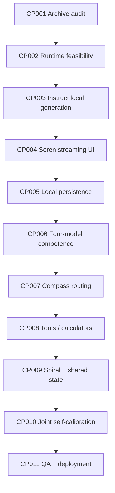

# Plan — Seren 7 Browser-Only Four-Falcon Execution Train

**Version:** 1.1 Web-only · **Prepared:** 2026-10-26 · **Plan state:** execution underway. Checkpoint headings below are original gates; current statuses and evidence are in `CHECKPOINT_LOG.md`.

## 1. Objective, ownership and guardrails

Deliver a verified **browser-only Seren 7 web application like ChatGPT**, with locally executed, offline-capable inference from the user-provided HTML interface, using **exactly four** Falcon-H1-Tiny 90M specialists: Instruct, R, Coder, Tool-Calling. Integrate B2 Compass, B2 Spiral, local calculators, shared-state memory and recoverable browser persistence in progressively testable stages. Exclude 135M, Qwen, all cloud LLMs, native applications and remote inference. Keep the original UI rather than rebuilding it. **No APK, native wrapper, Electron/Tauri desktop package, inference daemon or mandatory PWA installation in the present release.**

Any coding agent (Claude/Nemotron/Muse/Codex/Cursor) reads `AGENTS.md` and this file, executes **CP001 through CP011 in full** (starting at the first dependency-ready `NOT STARTED` checkpoint), and records reproducible evidence. No checkpoint is presumed complete because its design appears here. The project must not stop at CP001 or at the first successful chat demo.

## 2. Baseline and evidence register

| Item | Observed | Missing proof |
|---|---|---|
| Seren HTML | 1,160-line responsive concept, orb, sidebar, composer, theme, sample streams | Real local backend, persistence, mobile QA |
| Falcon Instruct ZIP | `part000` 34,209,792 B; `part001` 46,315,432 B | Reconstruct, archive integrity, model config/tokenizer, inference |
| Falcon R ZIP | `part000` 99,614,720 B; `part001` 46,368,895 B | Same |
| Falcon Coder ZIP | `part000` 99,614,720 B; `part001` 45,823,443 B | Same |
| Falcon Tool-Calling ZIP | `part000` 99,614,720 B; `part001` 46,343,913 B | Same |
| B2CCP | Earlier Brain2 project history describes execution mechanisms | Exact code version, model support, reproducible local integration |
| WebGPU/WASM | Browser APIs and standard inference libraries exist | Falcon-H1 hybrid architecture compatible and sufficiently fast |
| Magnetic Compass / .ASIF | Recovered architectural specifications and component experiments | Integrated Seren end-to-end proof |

Canonical Drive archive folder: https://drive.google.com/drive/folders/1IZhJVobJhXeeotVLGW3g54Kz0dxYqajo . Dedicated Instruct duplicate: https://drive.google.com/drive/folders/141t5B_EMfRgl_16oeCpTN1-YV49m9_rS . Preserve these read-only sources.

## 3. Dependency chain



Parallel tasks are allowed only when they do not race on the same source files or alter gate dependencies. Visual regression setup and test fixtures may begin alongside CP001–CP003.

## 4. Checkpoints and acceptance gates

### CP001 — Four archive reconstruction and identity (PASS; recovery caveat in ledger)

Tasks: acquire eight parts by exact Drive IDs; verify sizes and ordering; create temporary, correctly ordered reconstructed ZIPs; validate ZIP CRC, member list and extraction; inspect weights, `config.json`, tokenizer/chat templates; record license, source repo and checksums. Original Drive pieces remain unchanged. Some pieces live in a general model-ingress folder, not the empty specialist folders. Never declare model ready from a manifest alone.

Gate: **4/4 archives structurally complete, hashes and filenames recorded, exact architecture recognized, no unexplained duplicate/conflict.** Output: immutable model manifest and reproducible reconstruction report. If any parts are missing/corrupt, mark blocked and identify exact part ID.

### CP002 — Compute feasibility tournament (PASS for browser CPU path; see ledger)

Tasks: inspect any recoverable B2CCP kernels for a possible **browser WASM/WebGPU port**; probe in-browser WebGPU and WASM Falcon-H1 compatibility; if needed investigate ONNX conversion with faithful recurrent-state handling. Compare same weights/tokenizer/prompt across browser-compatible candidates. No native-only candidate can satisfy the release gate. Use official libraries as experimental comparators where appropriate and report failure modes explicitly.

Gate: at least **one real in-browser local neural inference path** for Instruct; deterministic input/output repeatability within documented numeric tolerance; successful tokenization and no hidden network calls. Capture OS/browser/GPU, model version, context length, TTFT, tokens/sec and peak RAM. If browser inference cannot work, mark the web release `BLOCKED` and propose a verifiable browser port; never switch to native/server inference or a fake model.

### CP003 — Local chat engine MVP (PASS for tested desktop CPU path; see ledger)

Tasks: implement `LocalModelAdapter` with load/generate/cancel/unload, prompt-template support, context and generation limits, streaming events and machine-readable errors. Support one Instruct model with genuine outputs. Never embed archived ZIP directly in JS bundle without memory/license assessment.

Gate: >20 diverse prompts produce real on-device tokens, with proper cancellation, timeout, memory tracking, negative tests (bad model, bad tokenizer, unavailable GPU). Network offline throughout inference.

### CP004 — Integrate existing Seren frontend (PASS for tested desktop/viewport UI; see ledger)

Tasks: preserve visual assets; replace `window.claude.use('sample')` production path and conceptual footnote; map model state/events; stop/regenerate/copy/speak; remove sample agent status and replace with real local task telemetry; display authentic backend and loading errors. Keep the original DOM/CSS system and hero-to-chat orb docking.

Gate: test manual chat to streamed answer end to end; no Claude/network calls; screenshot comparison at desktop/mobile breakpoints; real Stop halts generation; no UI-main-thread freeze.

### CP005 — Offline persistence and recovery (PASS for tested desktop browser; see ledger)

Tasks: **browser IndexedDB + OPFS** schema in `Schema.md`; thread CRUD/search; interrupted stream recovery; model cache; service worker/local asset caching including fonts when needed for offline revisit; privacy export/delete. Test browser quota and migration. Do not implement native SQLite or installer flows.

ADR-001 approved keeping the existing `seren7` database. A V2 → V3 browser migration test preserves 60 messages, two run-event streams and an OPFS model reference, then checks private deletion and future-version rejection. A separate browser test confirms JSON conversation export, deletion, reimport and invalid-file rejection; another confirms all app-owned IndexedDB records and model files are erased after confirmation. Quota, multi-tab races, long-term recovery and broader retention gates remain.

Gate: open the HTTPS/localhost web page, provision browser-local assets, disable OS network, refresh/reopen the cached site, resume >50-message history, stream a new reply, export/delete, and capture no remote inference egress. No PWA installation is required.

### CP006 — Four specialist profiles (PASS for diagnostic profile gate; see ledger)

Tasks: independently load Instruct, R, Coder, Tool-Calling; create disjoint train/calibration/held-out task sets. Score correctness, format adherence, abstention, tool choice, time/memory on each hardware profile. Record failure cases and source evidence. Do not assume roles by name.

Gate: all four run on at least one local execution path, with visible 4x competence matrix and output-format metrics. Benchmarks must be repeatable, blind to route training data and include negative controls.

### CP007 — Competence-aware B2 Compass (PASS: measured conservative fallback; specialist promotion remains gated)

Tasks: implement task classifier, policy, budget-aware model route, dynamic loading, fallback, explicit manual route, and local telemetry. Compare static routing versus Compass on held-out mixed workloads; measure real latency, not just fewer calculator attempts.

Gate: no correctness regression beyond pre-agreed tolerance; measured routing win or clear conservative fallback; genuine model labels and explanation categories visible in advanced inspector.

### CP008 — Local calculators and Tool-Calling (PASS: bounded local tool gate)

Tasks: register typed deterministic arithmetic, simple symbolic transforms and optional sandboxed code syntax tools. Model proposes tool JSON, validator checks schema and permissions, verifier checks exact output. No arbitrary shell or device mutation. Keep tool receipts.

Gate: exact positive/negative tests, unknown tool rejection, malformed arguments denial, timeout recovery and no unauthorized action.

### CP009 — B2 Spiral, R1/shared-state memory (NOT STARTED)

Tasks: bounded inner hypothesis/outer execution loops, residual analysis, dependency-ready calculator scheduling, exact shared-state indexing, proven-equivalence reuse, approximate similarity kept provisional, Heartbeat Delta replay/repair and .ASIF adapter only when validated.

Gate: synthetic and realistic repeated-state suites establish correctness, replay determinism, reuse hit rate and net end-to-end benefit; equivalent-state false positives = 0 on adversarial fixtures; fall back to baseline when overhead dominates.

### CP010 — Magnetic Joint Table and self-calibration (NOT STARTED)

Tasks: evaluate attraction/repulsion policies, TAP/ROTATE/EXPAND/CONTRACT/BRAKE/REPAIR/VERIFY transitions, hysteresis, candidate discovery, shadow trials, rollback and failure memory. Profile calibration drift and constrained device power use.

Gate: independent held-out comparison beats static policy in the chosen primary metric without loss of correctness or unacceptable latency/RAM increase. Unsuccessful candidates retained, not auto-promoted. New controller rules may improve only through approved evidence.

### CP011 — Web browser acceptance, static deployment and handoff (PARTIAL)

Tasks: build a reproducible **web release bundle** (HTML/CSS/JS/Workers/WASM and licensed static assets), smoke-test HTTPS/localhost serving, offline cache/revisit, browser storage, security, responsive mobile viewport, keyboard, themes, orb GPU context loss, cancellation, accessibility, browser refresh/restart and device thermal behavior. Validate local model import and asset-license notices. No APK, mobile/desktop binary, native wrapper or required PWA install. Static hosting may deliver files, but must not receive user prompts or perform inference.

Gate: tests signed off with measured receipts in a representative desktop browser and mobile web browser; end-to-end local inference works on each platform claimed supported; no remote inference, fabricated UI status, untested model substitution or hidden native binary; unsupported browsers documented honestly. Deliver web source/build, static hosting guide, offline readiness instructions and test report.

## 5. Test matrix and measurable KPIs

| Dimension | Baseline and measured output | Required rule |
|---|---|---|
| Conversation | Per-model accepted-answer and format rates | No fabricated neural output |
| Performance | TTFT, tokens/sec, p50/p95 latency, cold-load time | Report physical measured figures per device |
| Resource | Peak RSS, GPU memory, storage, CPU load, energy/thermal | Investigate <=500 MiB target, truthful exceptions |
| Routing | Accuracy, expected verification gain, abstention, route regret | Held-out comparison to static router |
| Shared state | Exact/equivalence correctness, hit %, residual cost | Never merge merely approximate states |
| Offline | Network-disabled request/response and restart | Zero remote inference calls |
| Reliability | Cancel, abort, crash, migration, corrupt model, retry | Recover without false answer or data loss |
| UI | Desktop/mobile visual QA, screen reader, reduced motion | Preserve original Seren appearance |
| Security | Model tool injection, arbitrary paths, private data exfil | Fail closed, explicit approvals |

Where a numeric threshold has not been grounded by hardware tests, first establish a baseline and get approval for a release threshold. Never retroactively choose a threshold that makes an already-run test look successful.

## 6. Roles, time and sequencing

Rough engineering duration: **5–8 weeks** if original B2CCP and model assets are recoverable; this is a planning estimate, not a commitment. CP001–CP004 constitute the highest priority working-demo critical path. Work split may be:

- **Engineering/runtime:** archive audit, adapters, model benchmarks, memory management.
- **Frontend/design:** preserve HTML, local status, accessibility and visual QA.
- **Verification/research:** datasets, competence maps, risk/negative tests, Compass tournaments.
- **Integration/QA:** browser-first offline assets, static web deployment testing, evidence ledger.

Agents may assume any workstream only after inspecting the same canonical documents and scoped files. Avoid simultaneous edits to shared configuration or UI main file unless coordinated.

## 7. Risks and stop conditions

| Risk | Response |
|---|---|
| Corrupt archive/missing tokenizer | Block model-ready flag; obtain exact missing asset, no silent substitute |
| WebGPU cannot run Falcon-H1 | Document unsupported operators; test in-browser WASM/B2CCP-port feasibility; no fake pass |
| B2CCP native code absent or browser-incompatible | Do not require native bridge; scope/verify optional WebGPU/WASM port, or mark web inference blocked |
| Four models overwhelm RAM | Load one at a time, measure quantizations and cold-switch cost |
| Browser model cache evicted by quota pressure | Warn, preserve recovery manifest, support user-controlled re-import into OPFS |
| Compass route degrades quality | Shadow comparison, revert to static conservative routing |
| Tool agent attempts unapproved action | Reject at allowlist/policy boundary |
| Self-calibration overfits | Holdout, calibration metrics, confidence bounds and promotion veto |
| Model license blocks redistribution | Clarify license scope before packaging weights |

## 8. Agent handoff / checkpoint receipt template

For every completed checkpoint append a dated entry to the implementation repository's `CHECKPOINT_LOG.md` (the current planning bundle should remain a clean baseline):

```
CP-ID:
Status: NOT STARTED | IN PROGRESS | PASS | PARTIAL | FAIL | BLOCKED
Date/agent:
Source revision:
Input artifact hashes / model and tokenizer version:
Device and execution backend:
Commands/fixtures used:
Actual outputs and metrics:
Failures/counterexamples:
Files changed:
Verification (independent checker):
Rollback procedure:
Next checkpoint:
```

The next agent first reads these receipts, the actual repository and the six specs; it never assumes another agent's optimistic summary is proof.

## 9. First actionable assignment

**Execute CP001–CP011, do not stop at CP001.** CP001–CP008 have passed their documented desktop browser or diagnostic gates. CP007 passes through its explicitly allowed conservative fallback: no specialist policy qualified for Auto promotion in the measured trials. CP008 passes for its bounded, compute-only local tool registry and exact/negative/timeout acceptance tests; it does not claim general symbolic algebra or model tool-selection reliability. CP011 remains partial; CP009–CP010 are not started. The next dependency-ready gate is CP009 shared-state and Spiral research. See `CHECKPOINT_LOG.md` for reproducible commands and unresolved failures. The final deliverable remains the **working web application**, not an APK.
