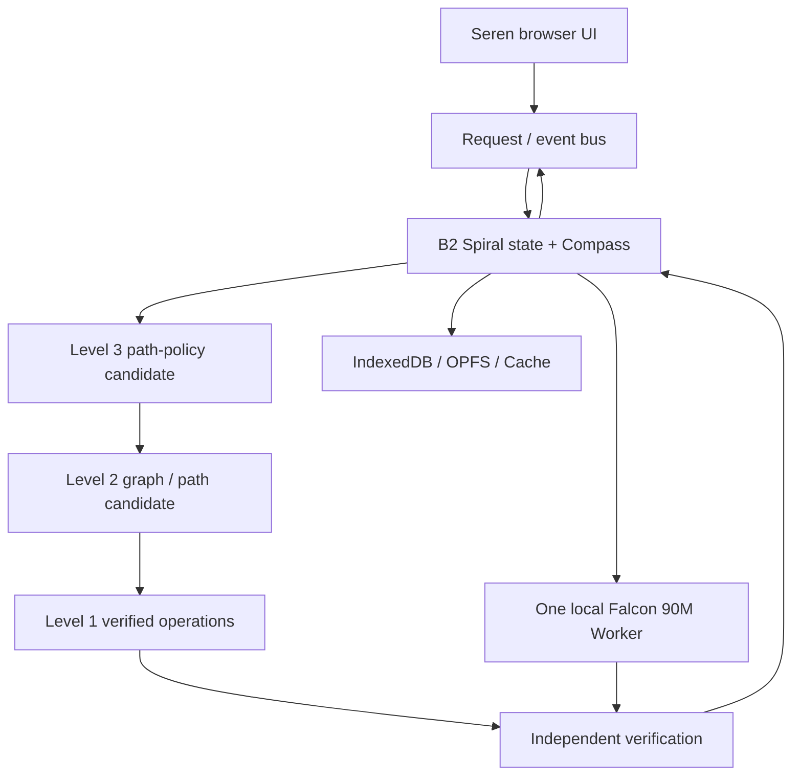

# Seren 7 — Consolidated Software Requirements Specification (CP023-DOCS, 2026-11-03)
**Status:** owner-requested combined V1 and V2 specification. Documentation-only; no V2 code or release proof is implied.
**Source of truth:** GitHub Enyx-D3/seren_ai main d2fd6bc (active V1 including narrow logic/code diagnostics), the committed concise SRS at `docs/Seren 7 SRS.md`, owner discussion through 2026-11-03, 2026-11-02 experimental CP010–CP022 handoff (not main-integrated), and preserved 810-line V1 SRS reproduced below.
**Precedence:** In any older V1 text below, "exactly one Falcon", "Coder prohibited", "no TinyLinux", and comparable constraints describe the protected default V1 product. The owner has authorized research on one additional *optional* Coder specialist and isolated tools for V2 only. V2's implementation and benchmark acceptance remain unverified.

## 1. Product vision and measurable outcome
Seren 7 is a local-first conversational AI application with an evidence-led B2 Spiral reasoning and execution coordinator. It must solve supported real user goals — conversation, accurate summarization, code, planning, retrieval, explanation, multi-step analytical problems — by selecting the smallest useful combination of verified deterministic tools, retrieval, model hypotheses and retained context. It must not be misrepresented as a mathematical word-problem-only product, a general frontier equivalent, or a demonstrated inference-speed breakthrough. A comparison against simple direct routing, one-Falcon V1 and both model choices is mandatory.

## 2. Actor, baseline and feature flags
- User runs the browser interface, can chat offline once resources are ready, inspect provenance/limitations, stop work, preserve/import/export conversation and choose allowed local features.
- Developer may run experimental MRS/Compass/capability probes and local benchmark; developer-only controls may not become ordinary user promises by accident.
- Default V1 remains one local Falcon-H1-Tiny Instruct ~90M and working recovery path.
- V2 proposes a second official Falcon Coder ~90M for code-specific tasks **behind a default-off research flag**, contingent on model identity/hash/licensing, browser memory/coexistence, offline operation, deterministic routing and held-out comparative tests.
- Optional WASM or isolated TinyLinux execution is a **restricted, capability-negotiated tool lane**, not arbitrary privileged host command access or mandatory Linux.
- No external inference, silent data upload, concealed larger-model substitution, new always-on daemon, auto-install, release or push follows merely from this SRS.

## 3. Functional requirements and acceptance definitions
| ID | Requirement | Verification / gate |
| --- | --- | --- |
| S7-FR-001 | Preserve original Seren 7 appearance, animated orb/planet, chat and stop controls. | Reference screenshot/motion comparison, reduced-motion alternative, mobile viewport and keyboard/a11y checks. |
| S7-FR-002 | Intake extracts task goal, source spans, constraints, unknowns, requested output and budget; annotate confidence and origin. | Multi-domain gold suite checks extracted facts plus deliberate ambiguity and contradictions. |
| S7-FR-003 | Represent problem as versioned GraphOS nodes/dependencies, claims, branch states and provenance. | Source-coordinate invariants, typed-delta replay and branch invalidation tests. |
| S7-FR-004 | B2 Spiral owns loop lifecycle from intake to complete/abstain, with explicit termination and progress. | Finite budgets, cycle/livelock tests and no recursive unbounded model calls. |
| S7-FR-005 | Compass generates and compares forward/backward/lateral/recovery paths using true task cost and evidence. | Ablation versus fixed routing; count steps, wall time, memory and correctness. |
| S7-FR-006 | Dispatch Level 1 mathematical, logical, structural and exact operations when appropriate. | Independent oracle and property-based unit tests, not solely language-model grading. |
| S7-FR-007 | Use Level 2 composed calculators and Level 3 psychological/flow orchestration only when real executable components exist. | Each claimed component has implementation ID, interface, receipt and frozen test; otherwise report not implemented. |
| S7-FR-008 | Model competence profiles learn from independent checked outcomes and abstentions; do not train on unchecked runtime exceptions or injected-fault shadows. | Cold/warm calibration, drift, rollback, sparse-profile, poisoning and browser reload tests. |
| S7-FR-009 | Optional Instruct and Coder models are task-routed by competence and budget, with a reversible default-off Coder flag. | Official model identity, memory bound, deterministic disabled-fallback and held-out code/noncode comparison. |
| S7-FR-010 | Permit only allowlisted WASM/Worker tools and opt-in isolated TinyLinux where proven supported. | Capability denial tests, resource limits, cancellation, path/network isolation and fallback. |
| S7-FR-011 | Support independently checked arithmetic, code tests, source quotations and verifiable intermediate claims. | Every VERIFIED claim links to checker, input/output, version, timestamps and receipt. |
| S7-FR-012 | Track residual uncertainties separately; do not silently turn a correct numeric result into full-explanation verification. | Wrong-Falcon-repair fixtures, partial-answer and user-facing abstention tests. |
| S7-FR-013 | Rotating joints, R1 state transitions and a bounded Cortex/self-correction loop may suggest updates but require explicit checking before promotion. | Candidate/reject/rollback logs, independent test gate, no runaway self-editing. |
| S7-FR-014 | Saved sessions, user data and learned profiles survive supported browser restart; allow export/reset. | IndexedDB/OPFS migration tests, corrupt-state restore, quota tests and private-data retention. |
| S7-FR-015 | Browser application must work on supported desktop and mobile, keyboard and screen-reader usable, with truthful progress, source and model labels. | Browser/device matrix including offline startup, interrupted download and low-memory fallback. |
| S7-FR-016 | Preserve provenance and prevent silent data exfiltration, unsafe code execution or unauthorized repository writes. | Threat-model, network inspector, CSP, sandbox and permission tests. |
| S7-FR-017 | Produce meaningful end-user answers in non-math domains: code repair, document-grounded synthesis, planning, search/retrieval, logic and multi-turn edits. | Frozen stratified held-out suite; compare task-success, correction loops, cost, latency and refusal/abstention. |
| S7-FR-018 | Release only when test, security, performance, UX, storage and regression gates pass independently. | Full npm tests, browser suite, offline smoke, build, 31-case frozen corpus, held-out domains, stress and release checklist. |

## 4. Non-functional requirements
- NFR-001 privacy: all inference local by default; external network activity only explicit, scoped and auditable.
- NFR-002 boundedness: per-run caps for memory, CPU, work units, model calls, tool calls, time, recursion and state growth.
- NFR-003 reproducibility: every benchmark records commit SHA, model hash, hardware/browser/runtime, warmup, seed, source set and raw receipts.
- NFR-004 reliability: partial verified subresults survive an error; recovery path must never conceal a failed full task.
- NFR-005 traceability: requirement-to-code-to-test-to-evidence ledger is mandatory, including missing implementation.
- NFR-006 compatibility: original V1 can be restored by disabling V2 experimental features without data loss.
- NFR-007 accessibility: color contrast, keyboard navigation, semantics, screen reader, reduced-motion while preserving animated reference for capable devices.
- NFR-008 honesty: label HYPOTHESIS, PARTIAL, VERIFIED, UNCHECKED, FAILED, AMBIGUOUS and UNSUPPORTED explicitly; no theoretical petavlops/virtual-memory performance claims without physical measurement.

## 5. State and receipt obligations
Canonical proposed identifiers: RunID, GoalID, GraphNodeID, SourceSpanID, BranchID, OperationID, ModelProfileID, StateVersion, CalibrationVersion, ReceiptID, ResidualID. A verified receipt specifies scope, independent verifier, inputs/hash and outputs/hash, source, time, tool/model identity, resource cost, hardware/browser and state lineage. No UI field can imply certainty outside the receipt's scope. Data contracts are design targets in `docs/Schema.md`, not migrations.

## 6. 14-checkpoint staged acceptance
Follow the explicit 14 checkpoint dependency table and owners in `docs/Plan.md`; CP0–CP4 older labels map to foundations, understanding, actual multidirectional reasoning, self-calibration and independent evaluation, not proof that the entire system is stuck on P0. New evidence must be merged and independently replayed before promotions. Published Seren 7 requires complete release gates and recovery from V1 state.

## 7. Test and benchmark minimum
Separate developer-authored from unseen tests; arithmetic, logic, multi-hop reading comprehension, grounded document claims, code generation/repair, planning, contradictions, vague inputs, fault recovery and malicious inputs. Compare 1) static direct tools, 2) V1 one-Falcon, 3) B2 with model disabled, 4) B2 + Instruct, 5) opt-in B2 + Instruct/Coder. Measure quality and cost: end-to-end wall time p50/p95, warm/cold start, verified task rate, refusal accuracy, wrong-claim rate, token throughput, energy proxy, RAM peak, tool/model calls and graph operations. Report cases and confidence intervals. Speed gains cannot be inferred from 168 ms on a single calculator case.

## 8. Provenance and status
At d2fd6bc, `b2-cross-domain.mjs` implements bounded source-grounded contradiction and JavaScript delimiter diagnostics with evidence; the local objective 4/4 and corrected six-case A/B math/logic 1/3 versus 3/3 are small developer-authored receipts, not broad competence proof. The earlier 11×9−16=83 proof, 4/4 supported local word examples, an injected calculator-fault recovery and three failed Falcon full-explanation repairs are **narrow historical receipts**. The 31-case frozen corpus was explicitly not run at that checkpoint. CP010–CP022 Stage4/5 materials describe further research prototypes, not evidence that current GitHub main has a shipped GraphOS or Coder worker. Treat all advanced module claims as experimental/unverified until exact source and test replay are available.

---

## Historical V1 SRS retained for complete requirement archaeology

# SEREN 7 — FULL SOFTWARE REQUIREMENTS SPECIFICATION (SRS)

**Product:** Seren 7 / Seren AI — Browser-Local Conversational AI with B2 Spiral
**Document ID:** SEREN-SRS-001
**Version:** 1.0 — consolidated requirements baseline
**Prepared:** 1 November 2026
**Status:** Proposed consolidated specification for engineering review; **not** a claim that every requirement has been implemented
**Source project:** `https://github.com/Enyx-D3/seren_ai`
**Primary audience:** Product owner, frontend/runtime developers, AI/research engineers, QA, designers, and incoming team members

> **Plain-language definition (বাংলায়):** Seren 7 হলো ChatGPT-এর মতো একটি ওয়েবসাইট, যেখানে AI মডেলটি ব্যবহারকারীর নিজের ব্রাউজারে চলে। এখানে একটি মাত্র Falcon 90M ভাষা মডেল থাকবে। **B2 Spiral** হলো তার মূল problem-solving engine: এটি লক্ষ্য বোঝে, সমাধানের পথ খোঁজে, প্রয়োজনীয় হিসাব ও যাচাই করে, ভুল বা অসম্পূর্ণ অংশ আলাদা করে আবার চেষ্টা করে, এবং যাচাই করা অভিজ্ঞতা থেকে পরবর্তী সিদ্ধান্ত উন্নত করার চেষ্টা করে। এই সম্পূর্ণ ক্ষমতা এখনো গবেষণা ও নির্মাণাধীন—এখন পর্যন্ত পরীক্ষিত অংশগুলো নিচে আলাদা করা হয়েছে।

---

## 0. How to read this SRS

This SRS describes **(a) the complete intended product**, **(b) what must be built and demonstrated**, and **(c) the narrower current evidence**. It must not be read as a feature-completion announcement.

**Requirement strength:**

| Marker | Meaning |
|---|---|
| **MUST** | Required for the stated acceptance gate. |
| **SHOULD** | Strong design requirement; a documented, reviewed exception is possible. |
| **RESEARCH** | Intended architecture or optimization not promoted until experiments verify it. |
| **FUTURE** | Explicitly outside the current web-only release. |

**Implementation evidence labels:** `VERIFIED`, `PARTIAL`, `EXPERIMENTAL`, `MISSING`, `BLOCKED`, or `NOT ASSESSED`. A passing unit test for a data structure does not prove a complete feature works on genuine model responses.

**Precedence:** Newest explicit owner decision → `AGENTS.md` and approved ADRs → `docs/PRD.md` → `docs/TRD.md`/`docs/Schema.md` → `docs/AppFlow.md`/`docs/UI_Spec.md` → `docs/Plan.md`. Disagreements require an explicit decision and corresponding document updates; they must not be silently resolved in code.

**Evidence cutoff:** This baseline incorporates the supplied `CHECKPOINT_LOG.md` entry through **1 November 2026** and a read-only local checkout of the project's earlier specifications. The latest uncommitted Mac working tree and its exact code diff were not available for independent examination. Evidence-based statuses therefore reflect reported checkpoint results, not a new full source audit.

---

## 1. Product overview

### 1.1 What Seren 7 is

Seren 7 is a privacy-oriented, responsive **website** for chatting with a genuinely local AI. The experience resembles a modern conversational assistant: a sidebar of conversations, central chat, streaming replies, a prompt composer, history search, settings, and an optional activity inspector. Behind the UI is **one** Falcon-H1-Tiny 90M Instruct model running inside the browser. B2 Spiral decides how a request is handled and may run deterministic operations without loading the model when language generation is unnecessary.

The website can be delivered over localhost or static HTTPS. Once the shell and approved model/runtime assets have been provisioned and cached, supported browsers MUST permit offline revisit and inference without contacting an external AI service.

### 1.2 Why the product exists

Small local models are private and potentially inexpensive, but can misunderstand complex requests, make incorrect calculations, and struggle to repair mistakes. Seren 7 investigates whether **a sophisticated external mathematical reasoning controller** can improve the usefulness of one small model without substituting a larger or additional language model.

The aim is improved **system-level task completion**, not unsupported claims that the Falcon neural weights have become inherently more knowledgeable or that an unverified plan has been proven correct.

### 1.3 Product outcomes

1. A user can start and continue real local chats in a premium browser UI.
2. User conversations and operational state remain under local browser control.
3. B2 Spiral manages each request from intake to final answer or honest stopping condition.
4. Exact, independently checkable subproblems can be handled by verified local calculations.
5. Complex work can be decomposed, routed, verified, repaired by residual, and recalibrated as implementation evidence permits.
6. Users can distinguish confirmed results, provisional claims, failed operations, and unavailable capabilities.
7. Engineers can reproduce model, correctness, performance, and privacy claims from stored evidence.

### 1.4 Explicit boundaries

**In scope now:** Browser-based website, one Falcon 90M Instruct model, local Worker inference, B2 controller, local computation and allowed tools, local state/history, offline access after provisioning, responsive UI, diagnostics and tests.

**Out of scope for this release:** Android APK, native iOS application, Electron/Tauri/desktop executable, native wrapper or background inference daemon, mandatory PWA installation, cloud LLM inference, remote chat database, external autonomous agents, subscriptions/accounts, automatic model fine-tuning, or additional language models.

**Do not add as fallback:** Qwen, SmolLM/LN135M, other Falcon R/Coder/Tool-Calling checkpoints, Claude/OpenAI APIs, or hidden hosted inference. Former four-model experiments are historical evidence only.

The original UI names `Seren 7`, `Swift`, and `Muse` are **presentation concepts**, not separate active models. Any retention or renaming as style/mode controls requires truthful UI labels.

---

## 2. Stakeholders, users, and scenarios

| User | Primary need | Example |
|---|---|---|
| Everyday user | Simple, private AI conversation | Ask for a short explanation and resume the thread later. |
| Student | Stepwise help and checked arithmetic | Ask a word problem and inspect which calculations are verified. |
| Programmer | Local explanations and code suggestions | Ask for a Python function and see whether it was syntax/functionally checked. |
| Researcher | Understand B2 path selection | Compare the same Falcon alone and with B2, with honest evidence. |
| QA/reviewer | Assess correctness and usability | Run blinded tests and verify offline behavior. |
| Project maintainer | Continue development safely | Recover requirements and evidence from docs, source, and checkpoint receipts. |

### Top-level use cases

- **UC-01:** First visit, verify/import the one approved model, begin chatting.
- **UC-02:** Start, stream, stop, regenerate, copy or read a response aloud when a local voice is available.
- **UC-03:** Perform independently verified arithmetic or bounded logic without an unnecessary Falcon load.
- **UC-04:** Request `Think deeper`; receive bounded B2 search/repair with honest partial results.
- **UC-05:** Allow a safe, typed local tool operation; deny disallowed or sensitive actions.
- **UC-06:** Create, search, rename, resume, delete, export, import and erase local conversations.
- **UC-07:** Reopen the provisioned site offline and resume conversation/model use.
- **UC-08:** Inspect selected operations, evidence, verification status and compute costs.
- **UC-09:** Encounter an unavailable runtime, corrupt model, quota problem or interrupted run and recover safely.
- **UC-10:** Independently evaluate whether B2 improves outcomes over the identical Falcon alone.

---

## 3. High-level system architecture



**Important:** This is the **target logical architecture**. It does **not** assert that Level 2/3, full Compass geometry or B2CCP are presently working in the shipped web app. Each target component requires an explicit capability status and independent test.

### 3.1 Runtime and component ownership

| Component | Responsibility |
|---|---|
| Browser UI | Presentation, user input, accessibility, truthful status, data controls. |
| Event bus | Request IDs, ordered streaming events, cancellation, error/terminal delivery. |
| B2 controller | Owns goal, graph, candidates, budget, verification, residual, repair and stopping. |
| Compass | Scores eligible directions and changes strategy using measured evidence. |
| Level 1 | Exact arithmetic, matrix/delta/lookup operations where independently verified. |
| Level 2 | Synthesize executable dependency paths, reusable subgraphs and computational structures. |
| Level 3 | Adaptively compose/select computational paths; “magnetic” is a proposed software policy. |
| Flow Processor | Admit and route work across available browser-safe resources subject to cost/permissions. |
| Falcon Worker | Load exactly one verified model and perform bounded, cancellable language generation. |
| Verifier | Independently check applicable facts/operations; never invent certainty. |
| State store | Persist history, verified facts, residuals, profiles, receipts and recoverable assets. |
| Experimental harness | Freeze fixtures, compare controlled baselines, retain negative results. |

### 3.2 Platform assumptions

- Supported runtime is a secure browser origin (`localhost` or HTTPS), not a raw `file://` release.
- Browser workers and storage APIs must be capability-probed; do not infer support from a browser brand.
- The **verified desktop baseline** is local Falcon Q4_K_M inference via CPU/WebAssembly in Chromium.
- WebGPU and browser-compatible B2CCP implementations are **candidate optimizations**, not guaranteed capabilities.
- The GPU-driven orb is visual-only and is not an inference accelerator.
- Static hosting may deliver approved assets, but must not receive prompts or run the user's inference.

---

## 4. Functional requirements — complete web application

The following IDs are stable traceability targets. An unimplemented item remains an open requirement.

### 4.1 Launch, setup, and model lifecycle

| ID | Priority | Requirement | Acceptance test |
|---|---|---|---|
| SER-FR-001 | MUST | Present a real website without any application installer. | Open over HTTPS/localhost in a supported browser. |
| SER-FR-002 | MUST | Provision or user-import **only** the approved Falcon-H1-Tiny-90M-Instruct GGUF. | Wrong model/format rejected; no specialist or online fallback. |
| SER-FR-003 | MUST | Validate artifact size/hash, tokenizer/config and compatible kernels before marking ready. | Corrupt/missing parts block inference with actionable error. |
| SER-FR-004 | MUST | Show model states `missing`, `verifying`, `ready`, `loading`, `loaded`, `failed`, `incompatible`. | Simulate each state and compare UI to actual engine state. |
| SER-FR-005 | MUST | Lazy-load the model only when a language operation needs it. | A deterministic exact-answer turn emits zero model-load commands. |
| SER-FR-006 | SHOULD | Provide device-aware inference settings and graceful unavailable-runtime fallback. | Unsupported WebGPU falls back to tested WASM or explains incompatibility. |
| SER-FR-007 | MUST | Keep user-selected model bytes in browser-controlled storage with explicit removal. | Reopen, inspect storage, remove without deleting unrelated conversation data. |

### 4.2 Chat, modes, and response interactions

| ID | Priority | Requirement | Acceptance test |
|---|---|---|---|
| SER-FR-010 | MUST | New chat and continuation of existing local conversation. | Stable conversation ID and correct message order. |
| SER-FR-011 | MUST | Stream actual model output from Worker; never scripted fake answers. | Tokens attributable to verified Falcon Worker and no cloud call. |
| SER-FR-012 | MUST | Send with Enter; Shift+Enter for newline; accessible mobile composer. | Keyboard and touch tests. |
| SER-FR-013 | MUST | Stop cancels actual inference, not only the text animation. | Worker cancellation acknowledgment; no stale tokens. |
| SER-FR-014 | MUST | Regenerate while retaining prior answer versions. | New candidate/version, previous response recoverable. |
| SER-FR-015 | MUST | Copy responses/conversation accurately. | Clipboard contains displayed content, with truthful button label. |
| SER-FR-016 | SHOULD | Read aloud through an available **local** voice. | Unsupported speech has clear disabled state; no remote voice dependency. |
| SER-FR-017 | MUST | Render safe Markdown and code blocks with selectable/copyable code. | Escapes scripts and unsafe URLs; handles long lines. |
| SER-FR-018 | MUST | Provide `Chat`, `Think deeper`, `Code`, approved `Tools`, and `Auto/B2` semantics without swapping models. | Mode changes actual bounded policy/budget; model identity stays one Falcon. |
| SER-FR-019 | MUST | Label deterministic checks separately from Falcon-generated content. | Calculator answer never counted as Falcon model success. |
| SER-FR-020 | MUST | Permit a provisional/partial/abstained outcome when complete verification is unavailable. | No false `Verified` badge for unchecked prose. |

### 4.3 Conversations, history, privacy

| ID | Priority | Requirement | Acceptance test |
|---|---|---|---|
| SER-FR-030 | MUST | Create, rename, search, delete and resume local threads. | Search and CRUD persist across refresh/restart. |
| SER-FR-031 | MUST | Atomically persist messages, run state and terminal outcomes. | Interrupted stream cannot silently become a complete verified answer. |
| SER-FR-032 | MUST | Export user-selected conversations to a documented format. | Export/re-import round trip; no model weights included by default. |
| SER-FR-033 | MUST | Validate imported conversation files and avoid ID collisions. | Bad-format, oversized and malicious input rejected. |
| SER-FR-034 | MUST | Delete selected conversations and their private derived state. | Cascade verified; global model package untouched unless selected. |
| SER-FR-035 | MUST | Offer `Erase all local data` with confirmation and precise scope. | All app-owned private DB/OPFS records erased; post-erase state shown. |
| SER-FR-036 | MUST | Version storage schemas and preserve prior conversations during migration. | V2→V3 migration and unknown-future-version rejection. |
| SER-FR-037 | SHOULD | Coordinate multiple tabs without inconsistent message writes. | Concurrent append/delete and refresh stress. |

### 4.4 Offline, tools, and user activity

| ID | Priority | Requirement | Acceptance test |
|---|---|---|---|
| SER-FR-040 | MUST | Reopen cached website and run local inference with network disabled after provisioning. | Full offline browser reload; zero external inference/telemetry requests. |
| SER-FR-041 | MUST | Execute only allowlisted, typed, browser-safe local operations. | Unknown tools/arguments denied; deadline and worker isolation enforced. |
| SER-FR-042 | MUST | Treat model-generated tool requests as proposals, never automatic authority. | Arbitrary shell/file/network instructions cannot execute. |
| SER-FR-043 | MUST | Require scoped explicit approval for sensitive or mutating actions if ever implemented. | Denial and no-permission tests; current registry has no arbitrary file mutation. |
| SER-FR-044 | MUST | Show genuine local task/agent status only. | No fake background workers, invented progress, or sample activity. |
| SER-FR-045 | SHOULD | Expose `Run details` with real model, operation, tool, verification, residual and resource receipts. | Display fields match stored events; missing data says unknown. |

---

## 5. B2 SPIRAL — complete understandable architectural specification

### 5.1 The central idea, without jargon

Imagine asking Seren to solve a difficult task. A conventional small language model tries to predict an answer in one continuous stream. It may guess, repeat itself, or make an arithmetic error. A basic wrapper might ask the model again if a checker complains.

**B2 Spiral is fundamentally different.** It is intended to act as a **navigator and computational organizer**. It asks: *What exactly is the destination? What parts of the task are already known? Which route could solve the remaining part most accurately and cheaply? Which operations can independently prove progress? Should the route expand, contract, reverse, rotate, branch, reconnect, or stop?* The small Falcon model is a language-capable participant, **not the owner of these decisions**.

The name **Spiral** expresses a controlled, adaptive search **toward a destination**. It is **not** an instruction to circle endlessly, loop the same prompt, or render a decorative 3D animation.

### 5.2 B2's non-negotiable principles

1. **Goal-directed convergence.** The destination is defined by explicit acceptance conditions, not just plausible prose.
2. **B2-first control.** Every request enters B2; simple requests may immediately take an economical direct route.
3. **Multidirectional search.** Search can move forward, backward, branch and rejoin rather than following a fixed chain.
4. **Evidence before promotion.** A Fluent Falcon claim is a hypothesis, not a verified fact.
5. **Compute where useful.** Use Level 1/2/3 operations only if applicable, available, and cost justified.
6. **Residual-only repair.** Preserve correct components; retry only the unmet requirement and its dependent work.
7. **State reuse with proof.** Identical/equivalent checked work may be reused; approximate similarity does not establish identity.
8. **Self-calibration.** Outcomes update strategy selection and competence estimates without silently training model weights.
9. **Bounded exploration.** Every search must have compute/time/branch limits, no-progress detection and an honest stop.
10. **Reproducibility.** Candidate paths, failed experiments and verification receipts remain inspectable.

### 5.3 Simple component glossary

| Term | Plain-English meaning | Technical responsibility |
|---|---|---|
| **Goal** | What success would actually mean | Explicit required outputs and acceptance tests. |
| **Compass** | Navigator choosing where to go next | Direction/strategy, depth, width, resources and stop/rollback policy. |
| **Spiral** | Revisable journey toward the goal | Branches, candidate operations, feedback loops and convergence. |
| **Base calibration** | Learn where the model/system starts | Measured task competence, available knowledge and cost profile. |
| **Level 1** | Reliable individual calculators | Validated arithmetic, matrix, delta and lookup operations. |
| **Level 2** | Build a calculation plan | DAGs, computational circuits, reusable subgraphs and reverse paths. |
| **Level 3** | Find the best arrangement of operations | Adaptive/“magnetic” path composition, selection and recalibration. |
| **Flow Processor** | Route work to appropriate resources | Admission and allocation among eligible browser-safe compute paths. |
| **Residual** | What remains unsolved or incorrect | Explicit open requirements and failed dependent nodes. |
| **Joint Table** | Catalog of useful relationships/routes | Versioned candidates, attraction/repulsion scores, proofs and failures. |
| **R1/Heartbeat** | Controlled state handoff/reuse idea | Identity, sequence, receipts, replay/repair and validated shared-state reuse. |
| **Verifier** | Independent checker | Proves only the specific claim within its declared scope. |

### 5.4 B2's governing state

Each request SHOULD have a versioned problem state containing:

- **Goal:** request, desired artifact, success criteria and exactness level.
- **Inputs:** user-provided facts with source spans and provenance.
- **Unknowns:** missing values, ambiguous interpretations and absent evidence.
- **Constraint graph:** nodes and dependency edges.
- **Evidence ledger:** model proposals, observed tool results, independently verified facts, contradictions and failed operations.
- **Residual set:** unmet conditions; each residual has an owner node, reason and priority.
- **Operations:** eligibility, preconditions, capability status, estimated gain/cost and proof source.
- **Compass state:** search direction, branch width, depth/horizon, rotation, selected path, policy version and uncertainty.
- **Resource budget:** remaining time, model calls, tokens, calculator calls, memory and branch limit.
- **Memory links:** exact/equivalent state IDs, proof/receipt and scope.
- **Stop condition:** verified complete, useful partial, clarification needed, budget exhausted, no-progress, disallowed action or failure.

### 5.5 Compass: an actual decision mechanism

The Compass **MUST** choose between eligible computational strategies. It is not merely a classifier labeling a user request `math`, `code` or `chat`.

A candidate's directional value may use:

\[
U(a\mid s)=w_p\,E[\Delta V]-w_t\,E[T]-w_m\,E[M]-w_r\,P(\text{wrong verification})+w_i\,E[I]+w_u\,E[R]
\]

Here `ΔV` is expected **verified goal progress**, `T` time, `M` memory/compute cost, `I` information gain and `R` safe verified reuse. This equation is **illustrative research notation**, **not** a recovered or validated canonical B2 formula. Weight selection, units, uncertainty, and candidate scoring must be tested against direct/static baselines. Missing data stays unknown—not silently zero or favorable.

Compass actions under consideration include `TAP`, `EXPAND`, `CONTRACT`, `ROTATE`, `SPLIT`, `MERGE`, `RECONNECT`, `VERIFY`, `REPAIR`, `ROLLBACK`, and `BRAKE`. Every implemented action **MUST** correspond to an observable graph/routing/budget change. The system must not claim behavior from names alone.

### 5.6 Multidirectional and dual-spiral design

The original vision includes a **goal-directed 3D/multidirectional spiral**, with potential inner and outer coupled processes:

- **Inner spiral:** explore assumptions, hidden relationships, constraints, hypotheses, counterfactuals, and unresolved mathematical residuals.
- **Outer spiral:** compare possible execution strategies, tool/processor choices, cost, risk, verified progress and calibration.
- **Compass link:** select branch width/depth, forward/backward horizon, rotation, expansion/contraction and resource allocation; reconnect compatible results when proven safe.

This is a **computational graph/search topology**, not necessarily literal geometric coordinates or a rendered animation. A valid first implementation may encode it as typed nodes/edges and transitions. Future geometric embeddings are useful only if they improve measured search behavior.

**Progress requirement:** The Spiral aims to reduce the remaining verified distance to the goal over bounded operation sequences. Some simulation steps may temporarily expand uncertainty; Compass must ensure that their expected information value justifies cost, or contract/rollback.

### 5.7 Level 1, Level 2, Level 3 calculators

**Level 1 — deterministic execution.** Execute small verifiable units: arithmetic, exact calculations, approved matrix/delta/lookup operations. Each has a typed contract, independent checker or known proof, timeout and measured resource cost. Only individually proven browser operations are `VERIFIED`.

**Level 2 — computational structure generation.** Construct executable dependency DAGs, matrix/circuit paths, calculation plans and reusable subgraphs. It must detect common subexpressions and select verified inputs for dependent nodes. A Markdown plan is not an executable Level 2 circuit.

**Level 3 — Magnetic Psychological Calculator.** The original term refers to a self-organizing **software strategy mechanism**, not physical magnetism or human psychology measurement. It proposes/assembles eligible Level 1/2 paths, considers a direct fallback, strengthens/dampens measured strategies, rotates or contracts when stuck, and selects a bounded execution plan. Its benefit is proven only when the generated path **actually executes** and beats a fair direct/static comparison without correctness regressions.

**Level distinction matters:** Simply creating files named `level1`, `level2`, and `level3`, or showing scores in the UI, does not satisfy integration. Tests must show how Level 3 changed an actual Level 2 path and how Level 1 operations executed that path.

### 5.8 Flow Processor and the single-model constraint

The Flow Processor proposes where eligible computational work should run: local deterministic worker, graph/matrix operation, checked-state reuse, or the **same** Falcon model when linguistic interpretation/generation is needed. It must account for actual device/browser capability, costs, privacy and user permissions.

Historical Brain2 work also named B2CCP, virtual calculators, one-bit/event-driven routing and R1 endpoint handoffs. They remain **separate integration hypotheses** until exact contracts and browser-compatible measured implementations exist. The current web release MUST NOT require native B2CCP or claim that R1 eliminates RAM or reconstructs unknown information without transmitting/preserving the necessary residual.

### 5.9 Base calibration and competence profiling

Before relying on Falcon for a kind of task, B2 SHOULD estimate its tested capability with a versioned **competence profile**:

- Task family (word math, logic, code, planning, conversation, extraction, etc.).
- Format-following/parse success.
- Independently graded correctness, with sample size and confidence bounds.
- Common failure modes and correction success.
- Runtime cost and device context.
- Evidence split and freshness.

**Key distinction:** A model's failure to emit structured JSON does not prove that it lacks the underlying knowledge; format failure and knowledge failure must be recorded separately. A calculator's correct result cannot count toward Falcon's model accuracy. Competence profiles guide Compass decisions but are not themselves independent proof of a new answer.

The self-calibration loop should update operation preferences from **checked** outcomes and monitor overfitting. The Compass may also assess its own scoring policy against alternative strategies. Changes that only suppress repeated failures must be reported as failure avoidance, not a demonstrated general reasoning gain.

### 5.10 Forward/backward simulation and oscillation

B2 SHOULD support **forward deduction** (from established facts toward the goal) and **reverse deduction** (from required outcome to missing prerequisites). It may simulate a small number of candidate paths without immediately spending the full execution budget.

Possible oscillation: briefly explore alternative strategies → execute the most promising verified-ready step → inspect residual and cost → exploit the successful route or rotate/contract. The system SHOULD retain useful partial discoveries from rejected paths, subject to privacy and storage limits, and stop on repeated no-progress states.

### 5.11 R1, Joint Table, and verified memory

**Shared state** means a prior proven result may avoid recomputation. Reuse types:

1. **Identical:** same canonical input and applicable version/scope.
2. **Equivalent:** different representations with a valid independently demonstrated equivalence proof.
3. **Similar/approximate:** useful for candidate search only; **never automatically exact**.

The **Joint Table** tracks candidate relations and paths, their applicability, measurements, confidence, version, failures, rollback and active/shadow/braked status. It may increase/decrease path priority based on evidence. Failed hypotheses remain as auditable data rather than disappearing after one trial.

R1/Heartbeat-style records may carry state identity, predecessor/dependency, sequence, receipt, acknowledgment and replay/repair data. Such receipts **do not, by themselves, guarantee cryptographic security or answer correctness**. Independently decode/recompute critical exact results when appropriate. .ASIF/B2M memory/indexing may be downstream browser-compatible adapters after separate proof; do not equate proposed storage with an implemented browser database.

### 5.12 Verification and truth labels

| Label | Allowed meaning |
|---|---|
| `MODEL_PROPOSED` | Falcon suggested content; no correctness proof. |
| `TOOL_OBSERVED` | Tool returned output; tool success does not prove the complete answer. |
| `VERIFIED_COMPONENT` | A specific claim/operation passed an applicable independent checker. |
| `PARTIAL` | Some required parts are complete; residuals remain. |
| `FAILED` | A test/operation failed or conflicts with checked facts. |
| `UNVERIFIED` | No adequate independent check exists, including most ordinary prose. |
| `VERIFIED_ANSWER` | **Every required assertion and condition** was independently covered at the appropriate evidence level. |

In particular, an exact number can be correct while the explanation is wrong. Structural planning checks (step count, presence of a risk line) **do not prove** semantic plan quality. Repeated Falcon agreement does not constitute independent verification. Mixed successful/failed tools cannot promote the whole reply to `Verified`.

### 5.13 Residual-only repair: required sequence

1. Record the original candidate and all required output conditions.
2. Verify checkable components; retain successful component receipts.
3. Identify the smallest **unmet** requirement and its dependencies.
4. Let Compass choose the next feasible repair operation, including a bounded call to the **same** Falcon if useful.
5. Preserve already verified nodes rather than rewriting them unnecessarily.
6. Validate the repaired component independently.
7. Recheck integration, contradictions and dependent nodes.
8. Update residuals, actual cost and competence counters.
9. Repeat while a productive operation remains and budgets permit; otherwise present a partial/provisional answer or abstain.

**No-progress brake:** an identical failed candidate, unchanged residual, exceeded budget, or unavailable trustworthy verifier is reason to stop or switch direction—not to repeat the same prompt indefinitely.

### 5.14 Pseudocode: intended Spiral loop

```text
function B2_run(request, budget):
    state = interpret_request_with_provenance(request)
    state.goal = explicit_acceptance_conditions(request)
    state.profile = load_checked_competence_and_operation_profiles()

    while within_budget(state):
        if all_required_nodes_independently_verified(state):
            return verified_final(state)

        candidates = collect_eligible_directions(state)
        candidates += propose_bounded_forward_and_reverse_paths(state)
        decision = Compass.select(candidates, state, measured_costs)
        if decision.none_or_unproductive:
            return honest_partial_or_abstain(state)

        transition = execute_approved_path(decision, state)
        checked = verify_each_applicable_claim(transition)
        state = preserve_verified_and_update_residual(state, checked)
        record_candidate_result_and_cost(decision, checked)
        calibrate_only_from_eligible_checked_outcomes()

    return honest_budget_limited_result(state)
```

This pseudocode is a **target behavior contract**, not a claim that the current code already executes all steps.

### 5.15 Walkthrough A — dependent arithmetic

**User:** “Calculate 2+2; then multiply that result by 3.”

1. B2 identifies goal: two linked results, final output 12.
2. Dependency graph: node A = `2+2`; node B = `A×3`.
3. Compass selects the validated calculator path.
4. Node A verifies 4; node B becomes ready and verifies 12.
5. Both nodes can be recorded as verified with exact input identity and scope.
6. No Falcon language call is required unless the user requests prose explanation.

**Evidence status:** A bounded form of this graph-driven reuse has been reported passing. It does **not** prove general semantic problem understanding.

### 5.16 Walkthrough B — natural-language word problem

**User:** “A shop sells 3 boxes with 12 pencils each. Eight pencils are returned. How many remain sold?”

**Intended** B2 interpretation: 3 boxes × 12 = 36 initially sold; 8 returned; remaining sold = 28. The system must associate each number with the correct semantic role, not merely extract the numbers `3,12,8` and choose an arbitrary operation.

1. Source-ground relevant quantities and their roles.
2. Create graph: `initial_sold = boxes × pencils_per_box`; `net_sold = initial_sold − returned`.
3. Independently verify each exact operation.
4. State final result 28, with the meaning of “remain sold” still dependent on verified interpretation.
5. If “returned” is ambiguous, clarify or mark the semantic mapping provisional.

**Evidence status:** Broad role extraction and grounded natural-language equation selection remain **PARTIAL/UNVERIFIED**. Previous development trials of complex Falcon JSON/extractive contracts produced **0/4** valid parses. A typed calculator does not solve an incorrectly interpreted question.

### 5.17 Walkthrough C — code task

**User:** “Write a Python function that returns the second-largest distinct number.”

**Intended** path: extract exact contract (distinct, insufficient inputs, types, edge cases) → choose language-generation operation → obtain Falcon candidate → validate syntax and run approved independent functional tests in a tightly restricted environment → report only tested behavior as verified, leaving untested claims provisional. If a test fails, repair the smallest failing behavior and re-run the affected tests. Do not treat a docstring as a proof.

**Evidence status:** A restricted development Python checker exists for benchmark cases. It is not a general safe Python execution sandbox; the current browser application must not run arbitrary generated code merely because the model requested it.

### 5.18 Walkthrough D — planning and conversation

**User:** “Give me a realistic four-step study plan, including time and one risk per step.”

**Intended** path: B2 tracks explicit requirements, asks Falcon for a proposal, checks structure and stated constraints, detects missing risk/time/step coverage, requests only missing material, and keeps the plan **provisional** until independent semantic assessment exists. Even a perfect four-step count does not prove practicality.

For ordinary factual conversation, B2 may select one efficient Falcon generation with honest uncertainty; it must not expend unnecessary Spiral branches or display fabricated verification.

**Evidence status:** The current repair code has shown structural attempts and **one** numerically aligned Falcon-led component in a separate math explanation probe, but **zero fully verified repaired answers** under corrected checking. Plan semantics remain unverified.

### 5.19 Core B2 requirements and acceptance

| ID | Priority | Requirement | Behavioral proof needed |
|---|---|---|---|
| B2-FR-001 | MUST | Every request begins under B2 control. | Trace shows B2-selected direct or complex path. |
| B2-FR-002 | MUST | Explicit goals, provenance, unknowns and required outputs. | Source-anchored state on unseen natural-language requests. |
| B2-FR-003 | MUST | Dependency-ready executable graph. | Correct dependent operation scheduling; blocked invalid dependencies. |
| B2-FR-004 | RESEARCH | Compass-controlled branching/rotation/contraction/convergence. | Actual change of graph/path; measured result against static baseline. |
| B2-FR-005 | RESEARCH | Level 1/2/3 path composition and Flow routing. | Level 3 chooses valid Level 2 path; Level 1 executes it; outcome independently checked. |
| B2-FR-006 | MUST | Explicit model/tool/provisional/verified distinction. | No false full-answer verification on adversarial mixed outcomes. |
| B2-FR-007 | MUST | Preserve valid facts and isolate residuals. | Failing node repaired without discarding established nodes. |
| B2-FR-008 | RESEARCH | Successful Falcon-led residual-only correction. | Previously unseen initial failure → focused model repair → independent full verification. |
| B2-FR-009 | MUST | Exact/equivalent state reuse only with proof. | Adversarial equivalence and stale-state tests. |
| B2-FR-010 | RESEARCH | Competence-calibrated strategy changes across task families. | Different operation selection + held-out utility; no leakage. |
| B2-FR-011 | MUST | No-progress brake and bounded compute. | Retry/branch caps, stable termination and clear partial state. |
| B2-FR-012 | MUST | Honest per-run receipts and status. | Reconstruct selected path, verification, failures and cost. |
| B2-FR-013 | RESEARCH | Reverse deduction, simulation and adaptive horizons. | Behavioral traces showing useful forward/back path changes. |
| B2-FR-014 | RESEARCH | Joint Table/R1 extensibility without false exactness. | State equivalence proofs and safe rollback; browser integration evidence. |

---

## 6. User journeys and UI specification

### 6.1 Original Seren design identity

**MUST preserve** the original polished Seren presentation rather than replacing it with a generic dashboard:

- Quiet, premium ChatGPT-like conversation interface.
- Desktop sidebar approximately 288 CSS px and a focused conversation column around 720 CSS px.
- Near-black and light theme variants; soft peach/pink/purple/teal gradient accents; mint live-status accent.
- Large animated gradient **orb** on greeting screen, visually reduced/docked when a chat begins.
- Fraunces-style display font, Onest-style UI text, DM Mono for technical content, with locally bundled fonts/fallbacks.
- New conversation, search, recent conversations, composer, mode/presentation controls and honest activity state.
- Mobile website with drawer, scrim, keyboard-safe composer, touch targets and safe-area padding.

### 6.2 Screens and states

| Screen/state | Required contents/behavior |
|---|---|
| Welcome/empty | Greeting/orb, new chat, prompt suggestions (suggestions are not generated replies). |
| Model preparation | One Falcon asset, actual verification/storage progress, error guidance, import/delete. |
| Active chat | User/assistant messages, genuine streaming, Markdown, Stop, copy, regenerate, optional local read-aloud. |
| Sidebar/drawer | Local conversation search/CRUD and real running tasks or empty state. |
| `Think deeper` | Actual bounded extra B2 work, not a cosmetic toggle. |
| Run details | One model identity, operation path, verified/unverified components, residuals, calls, tokens, time, and fallback. |
| Settings | Theme, reduced motion, local model/storage, data export/delete, browser capability and diagnostic privacy options. |
| Error/recovery | Model missing/corrupt, unsupported runtime, storage full, cancellation, tool denial, interrupted run. |

### 6.3 Visual truthfulness

- The orb represents **UI state**, not a real GPU speedup or physical Spiral computation.
- A spinner/activity counter MUST reflect real events; no scripted `3 agents working` or invented progress percentages.
- `Verified` applies only to independently checked required scope. `Partial`, `Provisional`, `Failed` and `Unavailable` remain distinct.
- A style selector must not present Swift/Muse as independent neural models.
- No hidden chain-of-thought is required. Display concise, factual action/verification summaries rather than fabricated internal reasoning.
- `Share` MUST be labeled `Copy conversation` until actual share functionality exists.

### 6.4 Interaction state machine

`EMPTY → READY → ROUTING → [LOADING] → GENERATING / CALCULATING → VERIFYING → COMPLETE`

Valid terminal alternatives: `STOPPED`, `ERROR`, `ABSTAINED`, `PARTIAL`, `OFFLINE_ASSET_MISSING`, `INCOMPATIBLE`. All transitions carry request identity and monotonic sequence. Previous request tokens cannot leak into a new conversation after cancellation or navigation.

### 6.5 Accessibility

Keyboard navigation; logical focus; Escape to close menus; labels on icon-only buttons; accessible status announcements without reading every token; reduced-motion preference; readable contrast; safe long-code scrolling; correct zoom and touch behavior. Screen-reader acceptance requires a physical/manual audit beyond automated DOM checks.

---

## 7. Data, memory, and interface contracts

### 7.1 Browser storage

The approved local storage model uses:

- **IndexedDB** physical database `seren7`, with V3 approved migration structure.
- **OPFS** for large verified model bytes/indices where supported, with documented fallback.
- **Cache API/service worker** for offline website shell/assets, without mandatory PWA installation.
- Local user-visible export and deletion.

Remote database, account identity, cloud telemetry and silent cloud synchronization are out of scope.

### 7.2 Logical entities

| Entity | Essential fields |
|---|---|
| Conversation | `conversation_id`, title, timestamps, mode, version, privacy scope. |
| Message | `message_id`, conversation, role, text, status, parent/version, run ID. |
| Model asset | `model_id`, exact version, format, digest, tokenizer fingerprint, browser-local path, load state. |
| Run/event | `run_id`, request ID, sequence, timestamps, event kind, metrics, terminal outcome. |
| Problem state | Goal, inputs/provenance, graph, established facts, residuals, remaining budget. |
| Compass decision | Eligible/rejected paths, factor evidence, policy version, uncertainty, reason. |
| Operation | Typed name, preconditions, capability, arguments/result, resource cost. |
| Verification | Subject/version, method, scope, pass/fail/partial/unknown, evidence. |
| Shared state/edge | Canonical identity, scope, exact/equivalent/approximate relation and proof. |
| Model competence | Task family, sample counts, format/accuracy measures, hardware, evidence split. |
| Joint policy/trial | Candidate relation, parameters, benchmark, measured outcome, rollback. |
| Calibration | Per-category checked outcomes, costs, decision version and persistence. |

**Status caveat:** Many are **logical target schemas**; presence in an SRS or IndexedDB store is not proof that the full corresponding B2 feature exists or is populated.

### 7.3 Conceptual B2 transition example

```json
{
  "schema_version": 1,
  "request_id": "example-request",
  "goal": { "kind": "answer", "criteria": ["return_exact_final_result"] },
  "facts": [
    { "id": "n1", "value": "4", "status": "verified_component", "verification_id": "check-n1" }
  ],
  "residuals": [
    { "id": "n2", "requires": ["n1"], "criterion": "multiply_by_3", "status": "pending" }
  ],
  "compass": {
    "policy_version": "example-only",
    "selected_operation": "exact_multiply",
    "decision_evidence": "n1 independently verified"
  },
  "budget": { "remaining_model_calls": 0, "remaining_tool_calls": 1 }
}
```

This is an **illustrative schema example**, not a guaranteed existing wire format. Current production schema fields, storage names and migration rules are authoritative in `docs/Schema.md`; changes require an ADR and tests.

### 7.4 Local message/Worker contracts

- Request envelope: schema version, request/conversation IDs, message, mode, budget and granted tool permissions.
- Streaming event envelope: schema version, request ID, monotonic sequence, timestamp, typed event and payload.
- Common events: accepted, route selected, model loading/ready, token, tool proposal/result, verification, fallback, complete, cancelled, abstained, error.
- Exactly one terminal event per run; stale/out-of-order messages rejected or quarantined.
- Worker cancellation must stop real generation and produce a terminal acknowledgment.

### 7.5 Retention, integrity, migration

- Versioned, idempotent forward migration; unknown future DB versions fail safely.
- Model weight checksums validate **artifact integrity**, not reasoning correctness.
- Shared-state checksums/receipts alone are not proof of mathematical equivalence or adversarial security.
- Private run/traces deleted with associated conversation according to the documented scope.
- Preserve evidence needed for research without silently retaining private prompt content in external storage.
- Never mix frozen benchmark ground truth into live user calibration.

---

## 8. Non-functional requirements

| ID | Domain | Requirement and evidence |
|---|---|---|
| SER-NFR-001 | Privacy | Default **zero prompt/history/telemetry egress**; offline network audit. |
| SER-NFR-002 | Performance | Measure cold load, time to first token, tokens/s, p50/p95 total latency and calls per task; publish device-specific results. |
| SER-NFR-003 | Memory | Investigate **≤500 MiB** peak where feasible on constrained hardware; this is a research target, **not a universal passed limit**. |
| SER-NFR-004 | Responsiveness | Inference in Worker; UI input, scrolling and Stop remain responsive. |
| SER-NFR-005 | Compatibility | Capability-detected Chromium/WASM baseline; other browsers/devices only when individually tested. |
| SER-NFR-006 | Offline | After initial approved provisioning, cached site and verified model operate with network disconnected. |
| SER-NFR-007 | Correctness | No whole-answer verification from partial tool success; no unverified fact promotion; adversarial negative tests. |
| SER-NFR-008 | Reliability | Handle interrupted stream, tab restart, quota, corrupted weights, stale worker output and multi-tab concurrency. |
| SER-NFR-009 | Security | Strict tool registry, bounded parsing/execution, sanitized Markdown, no arbitrary shell or unapproved external actions. |
| SER-NFR-010 | Accessibility | Keyboard, touch, safe areas, reduced motion, focus management and screen reader checks. |
| SER-NFR-011 | Reproducibility | Fixture hashes, runtime/build versions, source revision, raw outputs, independent checker and rollback receipt. |
| SER-NFR-012 | Maintainability | Modular components, documented contracts, versioned schemas and canonical document synchronization. |
| SER-NFR-013 | Licensing | Review model/third-party redistribution conditions before publishing model-included bundles. |
| SER-NFR-014 | Energy/thermal | Do not claim phone battery/thermal capability without physical-device measurements. |

Security notes: The restricted Python checker in development is **not** a generally secure sandbox for arbitrary generated code. Browser tools MUST use the applicable threat model and per-operation approval. User-supplied documents and model output are untrusted text; prompt injection cannot grant tool authority.

---

## 9. Acceptance, quality, and evaluation plan

### 9.1 Acceptance levels

| Gate | Required demonstration |
|---|---|
| **A0 — Website/runtime** | Real one-Falcon browser inference, streaming, Stop, local model verification and no cloud calls. |
| **A1 — Local product** | Persisted chat/history, export/delete, offline restart, responsive UI, tool safety and recovery. |
| **B2-P0 — Controller integrity** | Unit/browser regressions, no false verification on checked adversarial examples, sound result persistence. |
| **B2-P1 — Understanding** | Source-grounded semantic roles and dependencies **change real operation selection** on unseen word/code cases. |
| **B2-P2 — Reasoning** | A full model-led residual repair succeeds on an unseen problem and is independently verified without losing correct prior work. |
| **B2-P3 — Calibration** | Persisted competence and operation profiles change paths and show cross-category, held-out measured utility. |
| **B2-P4 — Evaluation** | Controlled same-model A/B, objective checkers, genuine blinded human semantic assessment, no major correctness/resource regression. |
| **MOBILE — Separate release gate** | Actual target-phone browser inference, UI, storage, power/thermal and accessibility assessment. |

### 9.2 Honest current status at evidence cutoff

| Area | Reported evidence as of 1 Nov 2026 | Current classification |
|---|---|---|
| Desktop browser runtime | One pinned Instruct Q4_K_M, offline Chromium CPU/WASM generation, local model preparation and streaming; tests passed. | **VERIFIED in tested desktop scope** |
| Chat, storage, UI | Desktop browser suites, offline reload, local history/export, desktop/viewport regressions passed; physical phone absent. | **PARTIAL release coverage** |
| B2-P0 | Unit and browser regressions; false verification bugs corrected. | **VERIFIED for tested gates** |
| B2-P1 | Source-grounded lexical/provisional hints exist. Four-case model JSON+retry and extractive-format trials each yielded **0/4** valid grounded parses; no useful general operation selection established. | **PARTIAL / experimental parse failed** |
| B2-P2 | On three new explanation cases, one Falcon second call aligned a numeric component; two failed; conflicting-claim false positive corrected. **Zero fully verified repaired answers.** | **PARTIAL** |
| B2-P3 | Checked arithmetic repair outcomes persist and can change a bounded decision; no demonstrated cross-category accuracy improvement. | **PARTIAL** |
| B2-P4 | Development objective comparison: **Falcon alone 7/23**, **Falcon+B2 13/23**. Six extra correct cases arise from deterministic math/Boolean. | **PARTIAL; no general reasoning proof** |
| Semantic A/B | All eight earlier rendered response pairs were identical. Audit found separate harness calls but identical prompts and no semantic B2 intervention; versioned follow-up produced no reviewable differentiated pairs. | **Nondiscriminating; cannot claim preference win** |
| Frozen confirmation | Separate 31-case fixture was prepared and preserved; **not run** at checkpoint cutoff. | **Pending** |
| Advanced Spiral | Multidirectional magnetic Level 3, full Level 2 graph/circuit synthesis, adaptive simulation/oscillation and broad R1/B2CCP integration not demonstrated. | **RESEARCH / MISSING** |
| Physical phone | Not available for actual browser, energy/thermal acceptance. | **BLOCKED / pending hardware** |

These are **reported project receipts**; they are not a fresh independent run performed while writing this SRS. Later checkpoints must update this table with source-controlled evidence rather than rewriting history.

### 9.3 Evaluation methodology

1. Freeze task fixtures, IDs, expected evidence and scoring rules **before** model execution.
2. Compare identical Falcon model bytes/tokenizer/sampling/hardware across Falcon-only and B2 arms, counterbalancing run order.
3. Separate **system-level deterministic tool gains** from **model-led reasoning gains** and **reuse/calibration gains**.
4. For executable tasks, use independent arithmetic/logic/functional checkers, validating conflicting claims and negations.
5. For planning/conversation, use blinded human reviewers; AI-assisted grades must be separately labeled and cannot stand in for human independence.
6. If both arms render identical text, the comparison is non-discriminating; audit call identity and output assembly rather than inventing a preference.
7. Never tune on the frozen confirmation set and then call a rerun independent held-out evaluation.
8. Measure latency, tokens, model/tool calls, cache reuse, verification errors, repair success, memory and energy (where device access exists).
9. Report raw failures, uncertain cases, and possible fixture/pretraining contamination.
10. Promote policies only when independent gains satisfy correctness, privacy and acceptable-resource criteria.

### 9.4 Test inventory

- Unit: parsers, exact arithmetic, model/tool schemas, graph readiness, Compass scoring, state transitions, no-progress brake, residual preservation, calibration versioning.
- Browser: actual one-Falcon load, lazy-load, streaming, cancellation, offline, refresh/restart, data controls, stale events, tool denials, UI smoke.
- Negative: malformed model, invalid import, storage pressure, mixed tool receipts, conflicting numeric claims, invalid dependency, same repeated repair, approximate-state false merge, unsafe code/tool proposal.
- Comparison: Falcon-alone versus Falcon+B2 on unseen word math, logical contradiction, coding, planning and conversation; independent semantic review.
- Hardware: desktop Chromium, other supported browsers if proven, physical mobile web QA and battery/thermal study.

**Representative existing development commands** (verify against the current `package.json` before use): `npm test`, `npm run test:browser`, `npm run build:web`, `node tools/browser_offline_smoke.mjs`, and relevant specific B2 probes. No command should be described as passed without an actual receipt.

---

## 10. UX acceptance and release checks

1. Empty/active chat visual fidelity at 320, 360, 390, 768, 1024 and 1440 CSS px as applicable.
2. Working drawer, composer, theme, copy, search, history, text/code wrapping and touch navigation.
3. Stream a real Falcon response; Stop halts the Worker; restart/resume does not alter prior answers.
4. B2 displays **real** direction/verification detail and no fabricated agent/model activity.
5. Correctly handles offline revisit, model absence, corrupted hash, quota, unavailable WebGPU, slow/cancelled tasks.
6. Local data export, delete and factory erase work as documented.
7. No runtime call to external AI, hidden analytics or remote chat processing.
8. Accessibility and reduced-motion checks complete; physical mobile/manual screen-reader sign-off remains a separate gate.
9. License and distribution review precedes public model-included static packaging.
10. Public deployment occurs **only** after explicit owner authorization; this SRS does not authorize deployment or Git pushes.

---

## 11. Implementation, ownership, and knowledge synchronization

### 11.1 Suggested workstreams

| Workstream | Responsibilities |
|---|---|
| Product/design | Visual fidelity, UX journeys, truthful statuses, mobile and accessibility QA. |
| Runtime | Model import/hash, tokenizer/Worker, browser compatibility, WebGPU/WASM experiments, memory and offline assets. |
| B2 research | Compass, hierarchical calculators, path search, Flow Processor, simulation, R1/Joint Table, calibration. |
| Verification | Deterministic oracles, bounded tool policy, negative fixtures, blind evaluation, performance/resource measurements. |
| Integration/QA | Storage/migration, smoke/regression, release packaging, reproducible checkpoints. |

### 11.2 Mandatory canonical document updates

This SRS complements, and must be synchronized with, these **six mandatory** canonical documents:

1. `docs/PRD.md` — product vision, scope, user value and acceptance.
2. `docs/AppFlow.md` — end-to-end user journey, B2 decisions, failure/recovery.
3. `docs/UI_Spec.md` — visual behavior, responsive states, inspector and accessibility.
4. `docs/TRD.md` — mathematical/runtime architecture, component contracts, security and resource strategy.
5. `docs/Schema.md` — versioned state, graph, Compass, Joint Table, receipts, migrations.
6. `docs/Plan.md` — dependencies, stages, proof gates, rollback and release conditions.

Also reconcile `README.md`, `AGENTS.md`, B2 architecture documents, ADRs, and `CHECKPOINT_LOG.md` as needed. **Every material checkpoint MUST** report affected code, documentation, tests, evidence and remaining gaps. Do not count documentation creation itself as behavioral implementation.

### 11.3 Minimum traceability record

| Requirement ID | Canonical document | Source module | Test/receipt | Status | Owner/next action |
|---|---|---|---|---|---|
| SER-FR-011 | PRD, TRD, AppFlow | `app/workers/runtime-worker.mjs` | Browser live stream/offline smoke | Tested desktop | Maintain/extend device matrix |
| SER-FR-030 | PRD, Schema, AppFlow | `app/js/store.mjs` | Browser storage/data-control tests | Tested desktop | Verify long retention/phone |
| B2-FR-003 | B2, TRD, Schema | Current graph/controller modules | Graph unit + real model path cases | Partial | Expand semantic readiness |
| B2-FR-008 | B2, TRD, Plan | Controller + verifier modules | New unseen repair receipts | Partial | Independently verified full repair |
| B2-FR-010 | B2, Schema, Plan | Compass/calibration modules | New held-out cross-category tests | Partial | Generalization evidence |

Actual file paths and versions MUST be rechecked against the latest working tree before marking a row verified.

### 11.4 Proposed dependency order

1. Preserve tested current application and evidence; audit code-to-spec gaps.
2. Make grounded semantic problem state and dependency structure reliably **change an actual operation**.
3. Make Compass route among at least two applicable, independently tested paths with measurable costs.
4. Integrate a bounded Level 2 graph generator and Level 3 path-selection policy, including direct fallback.
5. Demonstrate a real, independently verified, **full** Falcon-led residual repair.
6. Integrate persistent, checked state equivalence and broader Joint Table experiments without false promotion.
7. Demonstrate useful calibration changes across multiple unseen task categories.
8. Complete meaningful independent A/B, blinded semantic evaluation and separate physical mobile release gate.
9. Synchronize all six project-knowledge documents at **each** step, not only at the end.

### 11.5 Agent handoff receipt

```text
Checkpoint ID and date:
Scope / requirements addressed:
Git revision and dirty-worktree status:
Exact model artifact and runtime:
Code and knowledge documents changed:
Hypothesis, predicted outcome and actual outcome:
Commands, fixtures, hashes and raw outputs:
Independent verification and negative cases:
Accuracy, latency, calls, RAM, and device limitations:
Failures, counterexamples and unresolved residuals:
Status (verified/partial/experimental/blocked):
Rollback / compatibility:
Next dependency-ready task:
```

---

## 12. Risks, assumptions, and open decisions

| ID | Issue | Handling |
|---|---|---|
| R-01 | Falcon 90M may fail structured semantic formats. | Small source-grounded contracts, deterministic fallback, explicit abstention; do not promote invalid JSON. |
| R-02 | A better-looking plan may still be semantically wrong. | Distinguish format tests from factual/practical correctness; human blind review. |
| R-03 | More Spiral steps may slow the user experience. | Compare end-to-end costs with direct inference; use bounded fast path for easy tasks. |
| R-04 | R1/shared-state matching could merge unequal states. | Require proof/strict scope/version; adversarial equivalence fixtures. |
| R-05 | Calibration may overfit or corrupt evaluation. | Separate development/frozen holdouts; shadow policies and rollback. |
| R-06 | Browser storage may be evicted. | Quota alerts, recoverable model import, versioned persistence. |
| R-07 | Browser WebGPU/B2CCP may not support exact Falcon kernels. | Maintain verified CPU/WASM; mark unsupported paths unavailable. |
| R-08 | Mobile memory/thermal performance unknown. | Separate physical-device test; no unmeasured promises. |
| R-09 | Model/asset redistribution terms unresolved. | License review before publishing a model-included bundle. |
| R-10 | Historical multi-model/spec documents might reintroduce wrong scope. | Keep one-Falcon ADR authoritative; reconcile canonical six documents. |
| R-11 | “Magnetic”, “psychological”, or “3D” terms may be mistaken for implemented physics. | Define them as software policy/search hypotheses with observable contracts. |
| R-12 | A non-discriminating A/B packet cannot prove semantic gain. | Audit arm differences; preserve raw receipts; independently review only meaningful pairs. |

**Open owner/design decisions:** final visible names for `Swift` and `Muse` presentation presets; approved release thresholds per target device after hardware baselines; public distribution choice for model weights; future scope of any browser-compatible B2CCP/.ASIF adapter. These should not silently change the current one-model, web-only product.

---

## 13. Glossary for new engineers

- **LLM:** Language model that generates text; here exactly one Falcon 90M Instruct.
- **On-device inference:** Model calculations take place on the user's hardware, not a remote AI server.
- **Web Worker:** A browser execution context that can run tasks without blocking the visible UI.
- **WASM/WebAssembly:** Portable compiled code executable inside supported browsers.
- **WebGPU:** Browser API exposing eligible GPU compute; support for the *specific model* must still be demonstrated.
- **Quantization (Q4_K_M):** A compact numerical weight representation; file size is not equal to total runtime memory.
- **Dependency graph/DAG:** Directed relationship showing which results require other results.
- **Provenance:** Where a fact or operation came from and how it was checked.
- **Residual:** Explicit remaining work, missing knowledge, failed requirement or unresolved contradiction.
- **Compass:** The adaptive B2 mechanism for selecting computational directions.
- **Oscillation:** Controlled switching between exploration and exploitation with measured feedback.
- **Magnetic path:** A software scoring/composition hypothesis for which operations should be linked, prioritized or avoided.
- **Joint Table:** Versioned record of candidate relationships, paths, outcomes and rollback.
- **Verified:** Supported by an applicable independent check at the scope claimed.
- **Shadow policy:** Candidate policy measured without automatically controlling production behavior.
- **Held-out test:** A frozen evaluation set not used to fit, debug, or tune the policy being tested.

---

## 14. Source and evidence references

The following sources informed this SRS. The SRS is a **consolidation**, not an executed-code verification report:

1. `AGENTS.md` — universal engineering contract and active one-model/browser-only decisions.
2. `docs/PRD.md` — product and feature scope.
3. `docs/AppFlow.md` — user and operational journeys.
4. `docs/UI_Spec.md` — original Seren design fidelity and interactions.
5. `docs/TRD.md` — runtime, verification and browser security contracts.
6. `docs/Schema.md` — local storage and directional B2 logical schemas.
7. `docs/Plan.md` — historical CP001–CP011 gates and current B2 research stages.
8. `docs/B2_Spiral.md`, `docs/B2_V2_Evaluation_Protocol.md`, `docs/decisions/ADR-001*`, `ADR-002*`, `ADR-003*`.
9. Supplied `CHECKPOINT_LOG.md` through 2026-11-01, including semantic-probe, blind-pair audit, unseen-repair and regression receipts.
10. Owner's B2 Spiral history: goal-directed multidirectional topology, coupled inner/outer spirals, Compass, Level 1/2/3 calculators, Flow Processor, base/competence profiling, simulation/reverse deduction, Joint Table/R1/shared state, recursive self-calibration.

**Next source-control step (separately authorized):** Engineering should review this SRS against its *latest* uncommitted source and reconcile the six canonical specifications. Do not treat this artifact's existence as permission to overwrite those documents, push Git changes or deploy.

---

## 15. Final definition of done

Seren 7 is ready for its intended full B2 research acceptance only when it is **one working browser-local Falcon chat product**, with its conversational/storage/offline interactions tested, and **B2 Spiral actually controlling a measurable, adaptive, goal-directed computational process**: grounded understanding, Compass decisions that alter paths, executable hierarchy, verified-state preservation, useful residual-only repair, checked recalibration and independently measured benefit over the same Falcon alone.

Until then, the product must openly report the difference between **implemented functionality**, **restricted experimental successes**, and **the complete architectural destination**.
