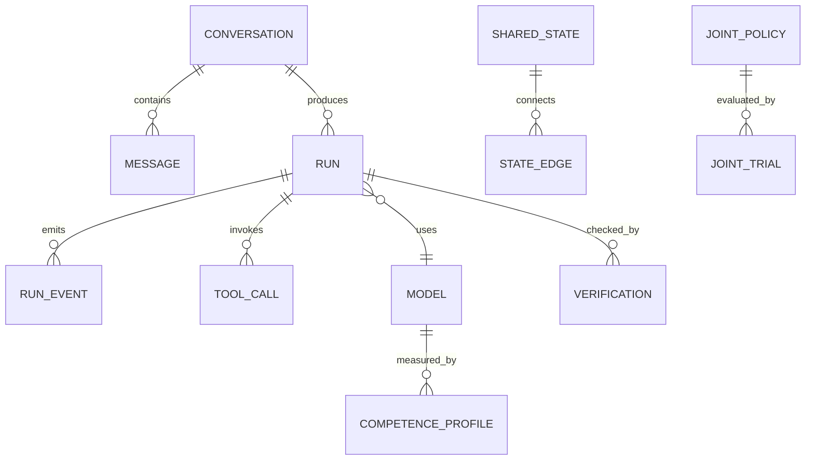

# Schema — Local Seren 7 Data and Event Contracts

**Version:** 1.2 Web-only · **Status:** logical design plus approved physical V3 mapping; remaining feature records/acceptance pending. Current evidence: `CHECKPOINT_LOG.md` and `docs/decisions/ADR-001-browser-storage-schema.md`.

## 1. Principles

- User data stays on-device. No server account, remote database, analytics collector or hidden sync.
- The only V1 storage backend is **browser IndexedDB + OPFS** (or a documented browser storage fallback). Native SQLite and filesystem daemons are out of scope. An optional .ASIF WASM indexing adapter must run in the browser.
- Separate **observed**, **proposed**, and **verified** states. A model suggestion must never become a verified fact by being persisted.
- Every durable state change has stable ID, schema version, timestamps, provenance and migration path.
- Conversations can be deleted/exported without accidentally deleting global model packages or unrelated profiles.
- Large binary weights live in local model storage, not duplicated in message rows. Do not store secrets or raw private reasoning traces unnecessarily.

## 2. Entity relationships



## 3. Primary records

### `models`

| Field | Type | Notes |
|---|---|---|
| `model_id` | enum PK | `falcon_instruct`, `falcon_reason`, `falcon_coder`, `falcon_tools` |
| `source_repo` | string | Exact source model ID/URL, not guessed |
| `artifact_version` | string | Local verified version/build |
| `format`, `quantization` | strings nullable | Verified from reconstructed archive |
| `artifact_root` | local opaque path/key | Never a cloud URL in normal execution |
| `sha256` | string nullable | Weight/package integrity receipt, not reasoning correctness |
| `tokenizer_fingerprint` | string | Config and chat-template fingerprint |
| `status` | enum | `missing`, `verifying`, `ready`, `loading`, `loaded`, `error`, `incompatible` |
| `memory_budget_bytes` | uint nullable | Configured cap, not a measurement |
| `last_verified_at` | timestamp nullable | Result of actual binary preflight |

Unique key: `model_id + artifact_version`. A source URL without local validated weights is `missing`, never `ready`.

### `competence_profiles`

| Field | Type | Notes |
|---|---|---|
| `profile_id` | UUID PK | Independent evaluation version |
| `model_id` | FK | Four-model roster |
| `task_family` | enum | chat, logic, code, tool, arithmetic, extraction, unknown |
| `benchmark_id`, `split_id` | strings | Prevent training/test leakage |
| `n_total`, `n_accepted`, `n_correct` | integers | Preserve format failures separately |
| `accuracy`, `format_success`, `abstention` | decimals | Measured rates |
| `brier`, `ece` | decimals nullable | Calibration where confidence is available |
| `ttft_ms`, `p95_ms`, `peak_mem_bytes` | numeric nullable | Actual device profile required |
| `hardware_profile_id` | FK/string | CPU/GPU/browser/quant context |
| `evidence_uri` | local key | Immutable evaluation report |
| `measured_at` | timestamp | Freshness |

Do not translate `0/48 accepted` into `0% knowledge` without inspecting task scorers and format failures. Profiles are empirical, scoped and versioned.

### `conversations` and `messages`

`conversations`: `conversation_id` UUID PK; `title`; `created_at`; `updated_at`; `active_mode` (`auto/chat/reason/code/tools`); `pinned`; `schema_version`; `deleted_at` nullable; `privacy_scope`.

`messages`: `message_id` UUID PK; `conversation_id` FK; `parent_message_id` nullable; `role` (`system/user/assistant/tool`); `text`; `status` (`pending/streaming/complete/stopped/error/unverified`); `model_id` nullable; `run_id` nullable; `version`; `created_at`; `completed_at` nullable; `token_count` nullable.

Assistant regenerations create new message versions/branches; do not mutate a prior answer without trace. For privacy, unrequested hidden model internal steps are not persisted.

### `runs` and `run_events`

`runs`: `run_id` UUID PK; `conversation_id`; `request_message_id`; `selected_mode`; `initial_policy_version`; `status`; `started_at`; `ended_at`; `token_budget`; `ms_budget`; `branch_budget`; `actual_model_ids[]`; `backend_kind`; `resource_metrics`; `verification_summary`; `error_code` nullable.

`run_events`: composite PK `(run_id, seq)`; `kind`; `timestamp_ms`; `payload_json`; `schema_version`. Monotonic `seq` prevents stale tokens. Event types match `TRD.md`. Terminal event is exactly one of `complete`, `cancelled`, `abstained`, `error`; replays are idempotent.

### `tool_calls`

`tool_call_id`; `run_id`; `proposer_model_id`; `tool_name`; `arguments_json`; `permission_scope`; `status` (`proposed/approved/denied/running/succeeded/failed`); `result_json`; `verification_id`; `elapsed_ms`. Enforce a versioned local registry and validate JSON schema before invocation. Never store an executable raw shell command as an approved tool just because a model proposed it.

CP008's physical `tool_calls` receipts use `id` as `tool_call_id`, `conversation_id` for deletion, `verification` as the method/status label, and additionally allow `timeout` and `cancelled` status. The bounded local tool worker records a final receipt for every parsed model proposal it attempts; conversation deletion removes these rows. The assistant message also retains a display receipt in `meta.tool_receipts` for export. No shell or user-file mutation tool is registered.

### `verifications`

`verification_id`; `run_id`; `subject_id`; `method`; `expected_contract`; `observed_result`; `status` (`pass/fail/partial/unknown`); `verifier_version`; `evidence_uri`; `timestamp`; `independence_level`. Keep results associated with a specific version of the candidate, not only a display string.

### `shared_states` and `state_edges`

`shared_states`: `state_id`; `canonical_encoding_version`; `content_identity`; `scope`; `confidence_kind` (`exact/equivalent/approximate`); `verification_id` nullable; `created_at`; `last_reused_at`; `reuse_count`; `payload_ref`.

`state_edges`: `edge_id`; `from_state_id`; `to_state_id`; `relation_kind` (`depends_on/equivalent_to/derived_from/contradicts/similar_to`); `proof_ref` nullable; `residual`; `policy_version`; `created_at`.

**Safety invariant:** `similar_to` is never treated as `equivalent_to` without an independent proof/guard. `content_identity` hash helps equality indexing but does not by itself prove a mathematical transformation is valid.

CP009 populates conversation-scoped `shared_states` with verified exact arithmetic expressions and values. The browser implementation additionally stores `canonical_expression`, `value`, and `value_digest`; only identical canonical text or proven two-atom `+`/`*` commutativity can reuse a value. Proven variants create `equivalent_to` edges. Heartbeat deltas and replay status live in message metadata; their checksum detects accidental replay damage, while exact arithmetic is recomputed on resume to verify the displayed answer. Approximate similarity and model prose are not cached as equivalent states.

### `joint_policies` and `joint_trials`

`joint_policies`: `policy_id`; `version`; `relation_kind`; `parameters_json`; `status` (`candidate/shadow/active/braked/rejected`); `created_at`; `parent_policy_version` nullable; `rollback_pointer`; `applicability_json`.

`joint_trials`: `trial_id`; `policy_id`; `benchmark_id`; `split_id`; `seed`; `baseline_metrics`; `candidate_metrics`; `uncertainty`; `verifier_id`; `outcome`; `started_at`; `finished_at`; `failure_notes`.

Promotions require recorded held-out gain in the task's primary verified objective without unacceptable correctness/privacy/resource regression. Negative experiments remain queryable.

CP010 stores the active bounded exact-tool Joint policy and its braked specialist predecessor in `joint_policies` after the exact route is used. The browser's `joint_trials` store accepts versioned evaluator records but the release comparison is preserved in source-controlled `evidence/joint-exact-*.json`; ordinary chats do not invent correctness labels or trial rows. Per-message metadata records the active policy version and deterministic verification. Factory erase removes both policy rows. There is no automatic model-policy promotion.

## 4. UI/runtime JSON event schemas

All browser Worker messages have `schema_version: 1`, `request_id`, `sequence`, `kind`, `timestamp_ms`, `payload`. Examples:

```json
{"schema_version":1,"request_id":"r-1","sequence":1,"kind":"route_selected","timestamp_ms":100,"payload":{"model_id":"falcon_instruct","backend":"wasm","reason_category":"chat"}}
```

```json
{"schema_version":1,"request_id":"r-1","sequence":2,"kind":"token","timestamp_ms":160,"payload":{"text_delta":"Hello"}}
```

```json
{"schema_version":1,"request_id":"r-1","sequence":3,"kind":"verification","timestamp_ms":200,"payload":{"status":"pass","method":"format_contract","verification_id":"v-1"}}
```

```json
{"schema_version":1,"request_id":"r-1","sequence":4,"kind":"complete","timestamp_ms":220,"payload":{"message_id":"m-2","tokens":12}}
```

Malformed or out-of-order events are rejected/quarantined. No UI updates should depend on event text parsing.

## 5. IndexedDB logical contract and physical V3 mapping

The logical entities are `models`, `competence_profiles`, `conversations`, `messages`, `runs`, `run_events`, `tool_calls`, `verifications`, `shared_states`, `state_edges`, `joint_policies`, `joint_trials`, `settings`, and `asset_receipts`. Per approved ADR-001, the **physical** IndexedDB name remains `seren7` to preserve existing user data. V3 has all entity stores except `settings`, which maps to the existing `kv` store. The existing `blobs` store is the OPFS fallback; V1 `events` is legacy and is not used for new run events. CP009 populates exact arithmetic shared states and proven-equivalence edges; CP010 populates active and braked Joint policy rows on use, while broad self-calibration trial rows are not fabricated from ordinary chat.

Current physical field mappings: `conversations.id` = `conversation_id`; `conversations.next_message_sequence` is an internal atomic append counter initialized from existing messages on first write; `messages.id` = `message_id`; `messages.content` = `text`; `run_events.request_id` = `run_id`; `kv.k`/`kv.v` = settings key/value. New stores use `id` as physical primary key while their logical IDs retain the names in section 3. Each new record must carry schema version, timestamps and provenance appropriate to its feature before it is considered conformant.

V3 indexes include `messages.by_conversation_created`, `messages.by_run`, `runs.conversation_created` and `runs.by_conversation`, `run_events.by_run_seq`, `competence_profiles.model_task_hardware`, `shared_states.identity_scope` and `shared_states.by_scope`, `state_edges.from` and `state_edges.by_to`, `joint_trials.policy_benchmark`, `models.by_status`, and `conversations.by_updated`. Legacy indexes remain for compatibility. Index presence does not imply records are populated.

Large model shards and serialized indexes belong in browser OPFS, referenced by stable content keys; use a documented browser fallback when OPFS is unavailable. A browser Cache API/service worker may cache the web shell/WASM assets but must not assume unlimited storage or require PWA installation. Use `navigator.storage.estimate()` where supported and warn before large provisioning. Implement a browser import/provision flow through user-selected file handles or approved static model asset downloads, with hashes.

## 6. Migrations, retention and deletion

Increment `schema_version` with forward-only, idempotent migrations; back up or export before destructive structural changes. V2 → V3 adds stores/indexes without deleting existing data; migration evidence is in `CHECKPOINT_LOG.md`. An unknown future DB version fails to open (`VersionError`) and blocks writes. Model artifacts and global evaluation receipts are separate from private conversations. User's `Delete all conversations` removes threads, messages, conversation-local runs, tool calls, verifications and private derived states; the browser test checks a synthetic cascade. The all-conversation JSON export has a validated, atomic browser import path that regenerates IDs; model weights are deliberately excluded. The confirmed `Erase all local data` control clears all app IndexedDB stores and imported GGUFs from OPFS; the offline shell cache stays so the site can still reopen. Report precisely what remains and what is recoverable.

## 7. Backward-compatible storage interface

```ts
interface LocalStore {
  createConversation(meta: Conversation): Promise<void>;
  appendMessage(message: Message): Promise<void>;
  appendRunEvent(event: RuntimeEvent): Promise<void>;
  getConversation(id: string): Promise<ConversationSnapshot>;
  getBestCompetence(modelId: string, task: string, hardware: string): Promise<CompetenceProfile | null>;
  findSharedState(identity: string, scope: string): Promise<SharedState[]>;
  exportData(selection: ExportSelection): Promise<Blob>;
  deleteData(selection: DeleteSelection): Promise<DeletionReceipt>;
}
```

An **in-browser .ASIF/WASM** backend may implement this interface after verified integration. Do not change UI code merely to switch storage. No native SQLite bridge or mobile app database is required in V1.

## 8. Schema acceptance

Run migration round-trips; >50-message conversation persistence; simultaneous stream/stop sequence tests; interrupted transaction rollback; stale event rejection; state equivalence false-positive fixtures; tool-permission denial; export/import; and user data erase. Verify local data never leaves device during these tests.
