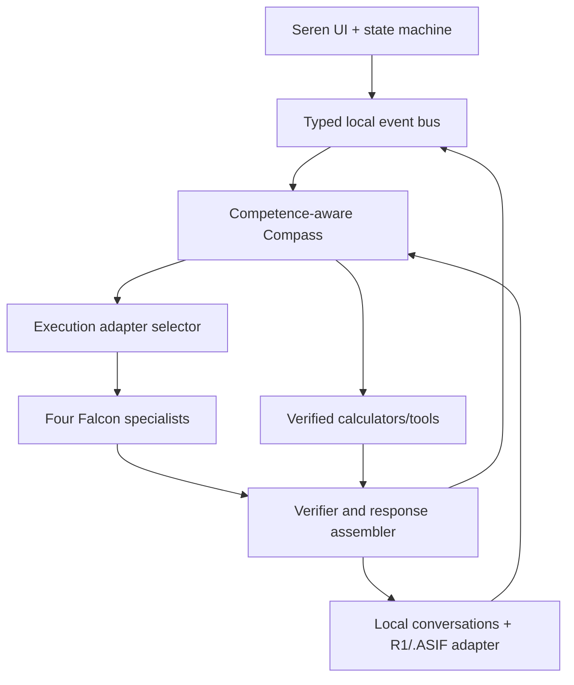

# TRD — Local Execution and Integration Architecture

**Version:** 1.1 Web-only · **Status:** target architecture; model/runtime compatibility unproven

## 1. Technology principle

No cloud inference backend or native companion process. The architecture is **static browser UI + Web Workers + device-local intelligence**. Choose browser adapters by measured hardware capability and validated Falcon-H1 kernels:

1. **WebGPU path** for browsers with a compatible GPU and a verified Falcon-H1 execution engine.
2. **WASM/SIMD CPU path** for browser fallback, if model kernels are supported.
3. **Experimental browser B2CCP port** compiled to WASM/WebGPU, only if real Falcon-H1 compatibility is demonstrated; not a native daemon, bridge or wrapper.

WebGPU is a compute API, **not itself an LLM loader**. The official Falcon-H1 variants are hybrid Transformer–Mamba; conversion to ONNX and ONNX Runtime Web compatibility must be experimentally established, especially recurrent/stateful operators and token streaming. Never assert that a WebGPU device automatically implies Falcon or B2CCP support; prove exact weights, tokenizer and outputs under each runtime.

Preferred **web-only release architecture**: select the first **verified in-browser** Falcon-H1 runtime (WebGPU preferred if compatible; WASM/SIMD fallback when compatible), run it inside a Worker and measure it on representative desktop/mobile browsers. A browser-compatible B2CCP port is an optional research/optimization route, not an excuse to require a native binary. If **no** browser runtime supports these exact weights, mark the neural runtime `BLOCKED` and document a porting plan; **do not secretly switch to server-side inference or a native app**.

## 2. Components and ownership



- **UI layer:** original HTML/CSS and modularized JS, controls, Markdown rendering, animation and accessibility.
- **Orchestration:** task classification, budget, competence registry, model load scheduler, cancellation, response assembly.
- **Model execution:** four exact Falcon variants, tokenizer/prompt template, context management, streaming decoder.
- **Tool fabric:** independent deterministic math, limited local structured tools, contracts and permissions.
- **Memory/state:** local persistence, content indexing, R1 Heartbeat Delta identifiers/sequence/receipts, safe reuse.
- **Experiment control:** shadow Compass policy tournaments, regression gates and rollbacks.

## 3. Model provenance and loading

Discovered Drive model archive pieces:

| Model | part000 bytes | part001 bytes | Total bytes |
|---|---:|---:|---:|
| Instruct | 34,209,792 | 46,315,432 | 80,525,224 |
| Reasoning R | 99,614,720 | 46,368,895 | 145,983,615 |
| Coder | 99,614,720 | 45,823,443 | 145,438,163 |
| Tool-Calling | 99,614,720 | 46,343,913 | 145,958,633 |

Source: https://drive.google.com/drive/folders/1IZhJVobJhXeeotVLGW3g54Kz0dxYqajo ; Instruct also in https://drive.google.com/drive/folders/141t5B_EMfRgl_16oeCpTN1-YV49m9_rS . Matching manifests exist, but ZIP contents and exact checksums have **not** yet been verified. Follow the physical split convention only after inspection; reconstruct to a temporary workspace, validate archive listing and file hashes, identify weights format, tokenizer, config, chat template, architecture and license. Keep original archives immutable. Do not equate compressed bytes with quantization or runtime RAM.

Official model cards use `tiiuae/Falcon-H1-Tiny-{90M-Instruct,R-90M,Coder-90M,Tool-Calling-90M}` naming patterns; read each exact model card, do not synthesize repo IDs from this shorthand. This is a Falcon-LLM licensed family; perform packaging review.

## 4. Local runtime capability probe

Probe on startup: secure context, Worker, WebGPU adapter/device limits and features, WASM SIMD/thread support, device memory/storage quota if available, model kernel compatibility and thermal behavior. Require `localhost`/HTTPS origin for browser WebGPU testing; do not ship a raw `file://`-only inference requirement. Use meaningful **in-browser** fallback when an adapter is unavailable.

Memory manager: single active specialist by default, optional warm standby only after benchmark; track weights, activations, KV/recurrent state, browser overhead and orb. Budget loading/unloading, cancel pending loads, and prevent two simultaneous model allocations from exceeding policy. If a target exceeds 500 MiB, record the result and choose a verified narrower device profile/quantization, not a false pass.

## 5. Local execution contracts

The API below is a **logical interface**, not permission to add remote HTTP. Use browser Web Worker `postMessage`/`MessageChannel`, streaming `ReadableStream` or async iterables. All inference, routing, tools, and message storage remain client-side. Localhost is only a static development server, not an inference API.

### Request

```json
{
  "schema_version": 1,
  "request_id": "uuid",
  "conversation_id": "uuid",
  "text": "user utterance",
  "mode": "auto",
  "budget": {"max_ms": 15000, "max_tokens": 256, "max_spiral_branches": 3},
  "permissions": {"local_read_tools": false, "local_write_tools": false}
}
```

Budgets are illustrative defaults and must be tuned by device. Disallow an unknown `mode`, arbitrary tools, or unbounded generation.

### Event envelope

```json
{
  "schema_version": 1,
  "request_id": "uuid",
  "sequence": 7,
  "kind": "token",
  "timestamp_ms": 123456789,
  "payload": {"text_delta": "hello"}
}
```

Event kinds: `accepted`, `route_selected`, `model_loading`, `model_ready`, `token`, `tool_proposal`, `tool_result`, `verification`, `fallback`, `complete`, `cancelled`, `abstained`, `error`. All events monotonic per request; stale request IDs ignored. Cancellation must propagate to the actual generation job and return terminal acknowledgement. Never treat incomplete token stream as verified final answer.

### Logical adapter interface

```ts
type RuntimeKind = 'webgpu' | 'wasm' | 'browser_b2ccp';
interface LocalModelAdapter {
  probe(): Promise<{available:boolean; reason?:string; limits?:Record<string,number>}>;
  load(modelId: 'falcon_instruct'|'falcon_reason'|'falcon_coder'|'falcon_tools'): Promise<void>;
  generate(request: GenerationRequest, onEvent: (event: RuntimeEvent)=>void, signal: AbortSignal): Promise<void>;
  unload(modelId:string): Promise<void>;
  metrics(): ResourceMetrics;
}
```

No concrete implementation is implied by this interface.

## 6. Competence-aware Compass

Task features: conversation/code/logic/tool/math/unknown, prompt length, local memory hit, required exactness, risk, budget and device state. Profiles store per-model sample count, accepted answer accuracy, calibration error, malformed output, p95 latency, cost and freshness. Selection uses an empirically calibrated score, not a universal winner:

`score(model, task) = E[verified progress] - lambda*latency - mu*memory - rho*risk + exploration_bonus`, with abstention and deterministic-verifier options. Parameters are experimental. Compare with static-routing baselines; prevent a policy from declaring victory using its own unverified score.

## 7. B2 Spiral and Magnetic Joint Table

Start with two bounded loops: inner explores hypotheses/variables, outer compares execution routes and resources. Both connect to Compass. Use versioned state, independent verification, a residual finder and at most a budgeted number of parallel branches. Candidates can `TAP`, `ROTATE`, `EXPAND`, `CONTRACT`, `BRAKE`, `REPAIR`, `VERIFY`. Magnetism is a **software-defined score/relationship field**, not physical magnetic force.

Initial joint relations: goal attraction, exact shared-state attraction, causal/complementary/novelty attraction, contradiction/duplicate/cost repulsion, temporal relation, oscillation damping/hysteresis. Each relation keeps algorithm version, parameters, evidence scope, applicability, confidence, cost and rollback. Approximate similarity never justifies exact state merge. New policies run in shadow on held-out tasks before promotion.

## 8. Tools and verification

Typed local tool registry examples: arithmetic, algebra, constrained solver, unit conversion, local document search (with user-selected files), code syntax check (sandboxed). The Tool-Calling Falcon proposes a registered name and valid JSON arguments; policy enforces allowlist, permissions, recursion depth, timeout, resource cap, and result verification. Model text is not an executable command. Sensitive operations require explicit user approval and cannot run silently.

R1/Heartbeat records carry state ID, predecessor/dependency, sequence, version, acknowledgement/replay/repair status and evidence. Compare actual decoded results for correctness. Do **not** claim R1-native receipts alone provide cryptographic integrity; use byte/hash checks where needed for model artifact integrity separately. Shared state may be reused when exact byte/state identity is established or mathematical equivalence is independently proven. Keep unverified approximate matches distinct.

## 9. Storage and offline packaging

**Only browser implementation for V1:** IndexedDB for metadata/messages, OPFS for large verified model assets and indexes (with documented fallback where OPFS is unavailable), Cache API/service worker for shell/WASM/fonts when offline revisit is required, storage quota preflight and versioned migration. A **browser-side** .ASIF/WASM adapter may replace or augment indexing after independent validation; no native SQLite database or local file daemon. Service worker caching is optional implementation machinery, not a requirement to install a PWA.

No remote inference, online analytics, unbounded service worker caching, or secret model download after first-run model provisioning. Package third-party licenses with distributed assets. Test the website with network blocked from OS/network panel after initial provisioning; distinguish website shell availability from model availability.

## 10. Build order and exit gates

Follow all `Plan.md` checkpoints. Before UI integration, prove one Falcon Instruct single-token and short response reproducibly **inside the browser**; measure browser process/device memory and ensure any model conversion is validated. Compare compatible WebGPU, WASM and browser-ported B2CCP candidates on identical prompts/model bytes. If support is missing, report `BLOCKED` with a feasible browser-port research plan; do not disguise an unrelated ONNX demo as Falcon execution or quietly ship native/server inference.

## 11. Security and quality

Validate imported model paths, archive parts, tokenizer metadata, input size, stored JSON, and Markdown. Sanitize all rendered content and use CSP appropriate to a static HTTPS-delivered website. Run model inference outside UI thread, avoid arbitrary `eval`, store only user-approved context, and allow full export/deletion. Log performance without private prompt bodies by default. Validate concurrency, cancellation, storage migration, stale Worker messages, device loss and incomplete model load. These checks must be evidenced, not just listed.
