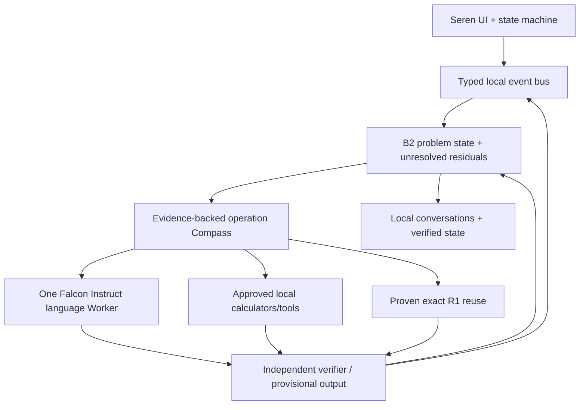

# TRD — Local Execution and Integration Architecture

## 2026-11-03 — V2 technical architecture contract (CP023-DOCS)

**Implemented boundary at `d2fd6bc`:** `b2-cross-domain.mjs` provides a bounded claim-pair logic parser, source offsets, forward/reverse JS delimiter scans, unknowns and independent local checks. These are strict grammars, not a generalized GraphOS parser, code-execution sandbox or L3 semantic reasoning engine.
**Version status:** Normative V2 experimental target; GitHub main `d2fd6bc` still runs the single-Instruct browser route. MRS CP010–CP022 reports are independent experimental handoffs, not merged main source.

**Request authority:** `B2 Spiral.run(goal, context, budgets)` owns every turn from intake through verified finish/abstain. Falcon responses are hypotheses/resources, never the controller. Core interfaces: `ProblemState`, `OperationCandidate`, `JointTransition`, `EvidenceReceipt`, `VerificationOutcome`, `StateDelta`, `Residual`, `ModelCompetenceProfile` and `CalibrationOutcome`.

**Hierarchy:** L1 — bounded exact arithmetic, Boolean, matrix and typed operations with independent oracles; L2 — executable dependency/calculation/ReasonGraph paths, shared subgraphs and proof-carrying composition; L3 — measured magnetic software policy that composes L1/L2/tool/model operations, picks paths, rotates/branches/contracts and brakes under no progress. "Magnetic/Psychological" is a software optimization hypothesis, not physics or proven cognition.

**Routing/Compass:** choose permitted `argmax` of conservative expected *verified goal progress* plus information gain and exact reuse, minus elapsed time, verification cost, RAM, failure/error risk and permission constraints. Scores carry version, calibration support count and uncertainty; unmeasured categories remain unpromoted. Compare direct/static path before adding complex graph overhead. Update only from independent outcomes; keep injected faults, unchecked exceptions and timing noise out of clean policy promotion.

**GraphOS/R1:** immutable/versioned state roots and source coordinates, strict identity or independently proven equivalence, dependency edges, rollback, source mutation invalidation, partial success retention, deny-repeat failure signatures, explicit residual. A stale `VERIFIED` badge must be revoked when its provenance invalidates.

**Execution lanes:** (1) local verified in-browser CPU/WASM Worker (existing); (2) hardware-probed WebGPU only when Falcon-H1 kernels are demonstrated; (3) a second official Falcon-H1-Tiny-Coder-90M GGUF behind a disabled feature flag, measured single/sequential/concurrent/adaptive modes; (4) approved browser WASM calculator Worker with termination; (5) optional TinyLinux/native process **research lane** requiring process-level termination, sandbox, resource caps, permissions, offline/privacy architecture decision and fault injection. Coder-generated tests cannot be the sole checker.

**Cortex:** independent claim checking, scope/provenance/version, positive and negative hallucination controls, failed-search versus nonexistence distinction, contradiction/semantic-translation audits, no self-certified proofs. Claim outcomes include VERIFIED, SUPPORTED_WITH_LIMITATIONS, UNVERIFIED, UNKNOWN, CONFLICTING, NOT_FOUND_WITHIN_SCOPE, SOURCE_UNAVAILABLE, PARSER_FAILED, VERSION_MISMATCH, REFUTED.

**Operational constraints:** existing original UI/one-Falcon fallback must remain functional; no cloud inference or hidden telemetry, no automatic access to arbitrary host commands. Documented native dual-Falcon throughput is not equivalent to browser execution; model-file bytes are not peak RAM; token throughput is not reasoning success.

**Verification:** independent unit/oracle and adversarial checks, real browser offline/Worker/cancel tests, staged GraphOS/TinyLinux mixed-task integration, seven-system baseline A/B, held-out model-led coding/planning semantic tests, physical-phone memory/battery; freeze model hashes, fixtures, run-order, environment and source version. A full verified repair must verify the *complete answer*, not a numeric component alone.

**Cross-domain execution contract (2026-11-01, bounded):** `b2-cross-domain.mjs` extracts two quoted atomic claims or one fenced JavaScript span into facts, unknown, constraints, dependencies, verifier and two executable paths. `SpiralController.run` constructs this state before generation; `selectDirection` scores eligible operations using predicted count and checked local profiles. A failed path can rotate to its unvisited alternative. Logic compares polarity and independently enumerates assignments under the stated same-time/context reading. JavaScript is never evaluated: forward and reverse delimiter scans must agree. Template strings and non-comment slash syntax are excluded because they require a full lexer. A same-Falcon proposed repair passes only if it inserts exactly one expected delimiter, preserves every other character and both scans pass. This certifies delimiter structure only. Unsupported semantics, full syntax and program behavior remain unverified. General Level 3 policy and independent A/B gain remain open.

**Shadow provenance safety:** Supplying a custom arithmetic callback to a shadow trial automatically marks it simulated/untrusted, even without an explicit simulation flag; such trial results cannot enter clean observed-route profiles. This prevents a controlled calculator fault from silently poisoning future measured policy decisions.

**Production paired-path safety guard:** Sparse independently checked outcomes in one exact path must not cause the unmeasured alternative to outrank it. Word/transfer paired paths first compare declared exact operation counts until both have at least three checked outcomes; with similarly observed correctness, cost remains the tie-breaker. The guard is a conservative engineering policy, not proof of globally optimal routing.

**2026-11-01 calibration evidence pipeline:** `b2-calibration-outcomes.mjs` is the central per-operation reducer used by `main.mjs` before persisting `kv.spiral_calibration_v2`: only `checkedOutcome === true` permits `verifiedSuccesses` or `verifiedFailures`; other attempts increment `uncheckedRuns`. Strict word/transfer evaluators now flag only independently observed mismatches as checked failures. `b2-shadow-trials.mjs` separately executes both candidate exact routes in an explicit research call; its outputs are arithmetic-conditional receipts, never human semantic grades. Clean measured results can be JSON-serialized into a separate `shadowOperations` map and read by `experimentalMagnetic:true`; ordinary routing does not run the trial. The Level 3 score now floors normalized runtime cost by independently known operation count because low-millisecond timing alone caused a measured compute regression in the first comparison. No target-device, browser reload or energy gain has been proven.

**Bounded transfer + Level 3 shadow experiment (2026-11-01):** `b2-transfer.mjs` parses two named inventories, a directional give-transfer and one final count question with quoted source spans and item-unit checks; the goal graph depends on both initial counts and the transfer. `transfer_direct` computes the target update; `transfer_conserve` computes total, other-party final and their difference. Every executed expression uses the dual exact evaluator, and the final result is checked against the direct mathematical identity. A bad calculation rotates to the other path, with failed and checked prefix receipts preserved. `b2-magnetic.mjs` evaluates paths using smoothed independently checked success rates and measured cost, requiring at least three checked outcomes **per candidate**; ordinary routing remains conservative. `SpiralController.run(..., { experimentalMagnetic: true })` is a developer-only experiment that can alter the selected path when supplied complete measured profiles. Synthetic-profile selftests show a change of path on an untrained question, not real accuracy advantage. No additional model, remote inference or runtime backend is introduced.

**Goal-progress slice (2026-11-01):** `b2-direction.mjs` now computes `measureGoalProgress(state) = (verified required tasks / required tasks, verified component count, unresolved required tasks, open residual count)`. Only independent `verified` task receipts increase completion; verified components are retained but never satisfy the parent task. `recordSpiralOutcome` and `recordVerifiedComponent` emit pre/post snapshots and deltas; task results report `verified_advance` or `no_verified_advance`. This is an observable conservative progress measure, not a proven general search objective. Resource cost remains a separate measured field; future Compass policy must experimentally derive and compare its value function against direct and static routes before promotion. Browser Level 3/B2CCP interfaces remain unavailable.

**Bounded word path:** `b2-word-math.mjs` accepts only fully matched grouped-count/add-or-remove wording with source offsets, compatible singular/plural units, bounded positive counts and a final-count question. It proposes a multiplication path and, for at most 12 groups, a repeated-addition path. `b2-direction.mjs` compares their exact-operation count until both have at least three measured local runs; only then may score evidence compare measured costs. This avoids a smoothed success score accidentally favoring an unmeasured, more expensive path. Each step uses `exactArithmetic`'s independent evaluator contract, with a second result comparison; a failed step cannot verify the answer. `SpiralController` records path failure, verified prefix, alternative choice, actual calls and goal progress. The direct/static multiplication route uses the same parser and serves as the cost comparator. This is a narrow Level 1/2 slice, not promoted Level 3.

**ADR-002/ADR-003 active architecture:** Runtime/ingest/build allow only pinned Instruct Q4_K_M. All user turns pass `SpiralController`; the target controller owns problem state, dependency-ready operation choice, independent verification, residual-only redirection and exact shared-state reuse. The same Falcon handles language hypotheses and presentation. Historical four-model part sizes below are provenance only. Current code implements only a subset of the directional contract, and no model self-critique is independent proof.

**B2 V2 verification rule:** A checked tool operation is not proof of a full open-ended answer. Preserve every failed and successful tool receipt; a mixed set stays unverified. An incomplete multi-part task cannot be marked verified. Version V2 software calibration separately from V1 and use a minimum of three checked outcomes before increasing repair budget. The exact controller contract and remaining validation gaps are in `B2_Spiral.md`.

**Version:** 1.1 Web-only · **Status:** target architecture; Chromium CPU/WASM path proven, other runtimes and release compatibility unproven. Current evidence: `CHECKPOINT_LOG.md`.

## 1. Technology principle

No cloud inference backend or native companion process. The architecture is **static browser UI + Web Workers + device-local intelligence**. Choose browser adapters by measured hardware capability and validated Falcon-H1 kernels:

1. **WebGPU path** for browsers with a compatible GPU and a verified Falcon-H1 execution engine.
2. **WASM/SIMD CPU path** for browser fallback, if model kernels are supported.
3. **Experimental browser B2CCP port** compiled to WASM/WebGPU, only if real Falcon-H1 compatibility is demonstrated; not a native daemon, bridge or wrapper.

WebGPU is a compute API, **not itself an LLM loader**. The official Falcon-H1 variants are hybrid Transformer–Mamba; conversion to ONNX and ONNX Runtime Web compatibility must be experimentally established, especially recurrent/stateful operators and token streaming. Never assert that a WebGPU device automatically implies Falcon or B2CCP support; prove exact weights, tokenizer and outputs under each runtime.

Preferred **web-only release architecture**: select the first **verified in-browser** Falcon-H1 runtime (WebGPU preferred if compatible; WASM/SIMD fallback when compatible), run it inside a Worker and measure it on representative desktop/mobile browsers. A browser-compatible B2CCP port is an optional research/optimization route, not an excuse to require a native binary. If **no** browser runtime supports these exact weights, mark the neural runtime `BLOCKED` and document a porting plan; **do not secretly switch to server-side inference or a native app**.

## 2. Components and ownership



- **UI layer:** original HTML/CSS and modularized JS, controls, Markdown rendering, animation and accessibility.
- **Orchestration:** versioned problem state, dependency graph, residual analyzer, operation registry, evidence-scored Compass, bounded recursion, cancellation and response assembly.
- **Model execution:** one exact Falcon Instruct, tokenizer/prompt template, context management and streaming decoder.
- **Tool fabric:** independent deterministic math, limited local structured tools, contracts and permissions.
- **Memory/state:** local persistence, content indexing, R1 Heartbeat Delta identifiers/sequence/receipts, safe reuse.
- **Experiment control:** shadow Compass policy tournaments, regression gates and rollbacks.

## 3. Model provenance and loading

Discovered Drive model archive pieces:

| Model | part000 bytes | part001 bytes | Total bytes |
|---|---:|---:|---:|
| Instruct | 34,209,792 | 46,315,432 | 80,525,224 |
| Reasoning R | 99,614,720 | 46,368,895 | 145,983,615 |
| Coder | 99,614,720 | 45,823,443 | 145,438,163 |
| Tool-Calling | 99,614,720 | 46,343,913 | 145,958,633 |

Source: https://drive.google.com/drive/folders/1IZhJVobJhXeeotVLGW3g54Kz0dxYqajo ; Instruct also in https://drive.google.com/drive/folders/141t5B_EMfRgl_16oeCpTN1-YV49m9_rS . CP001 archive recovery and GGUF checksum evidence is recorded in `CHECKPOINT_LOG.md` and `workspace/models/MANIFEST_LOCAL.json`; Instruct and Coder source ZIP parts were truncated and recovered from matching official files. Keep original archives immutable. Do not equate compressed bytes with quantization or runtime RAM.

Official model cards use `tiiuae/Falcon-H1-Tiny-{90M-Instruct,R-90M,Coder-90M,Tool-Calling-90M}` naming patterns; read each exact model card, do not synthesize repo IDs from this shorthand. This is a Falcon-LLM licensed family; perform packaging review.

## 4. Local runtime capability probe

Probe on startup: secure context, Worker, WebGPU adapter/device limits and features, WASM SIMD/thread support, device memory/storage quota if available, model kernel compatibility and thermal behavior. Require `localhost`/HTTPS origin for browser WebGPU testing; do not ship a raw `file://`-only inference requirement. Use meaningful **in-browser** fallback when an adapter is unavailable.

Memory manager: one active Instruct model; track weights, activations, KV/recurrent state, browser overhead and orb. Budget loading/unloading and cancel pending loads. If a target exceeds 500 MiB, record the result and choose a verified narrower device profile/quantization or mark the device unsupported, not a false pass.

## 5. Local execution contracts

The API below is a **logical interface**, not permission to add remote HTTP. Use browser Web Worker `postMessage`/`MessageChannel`, streaming `ReadableStream` or async iterables. All inference, routing, tools, and message storage remain client-side. Localhost is only a static development server, not an inference API.

### Request

```json
{
  "schema_version": 1,
  "request_id": "uuid",
  "conversation_id": "uuid",
  "text": "user utterance",
  "mode": "auto",
  "budget": {"max_ms": 15000, "max_tokens": 256, "max_spiral_branches": 3},
  "permissions": {"local_read_tools": false, "local_write_tools": false}
}
```

Budgets are illustrative defaults and must be tuned by device. Disallow an unknown `mode`, arbitrary tools, or unbounded generation.

### Event envelope

```json
{
  "schema_version": 1,
  "request_id": "uuid",
  "sequence": 7,
  "kind": "token",
  "timestamp_ms": 123456789,
  "payload": {"text_delta": "hello"}
}
```

Event kinds: `accepted`, `route_selected`, `model_loading`, `model_ready`, `token`, `tool_proposal`, `tool_result`, `verification`, `fallback`, `complete`, `cancelled`, `abstained`, `error`. All events monotonic per request; stale request IDs ignored. Cancellation must propagate to the actual generation job and return terminal acknowledgement. Never treat incomplete token stream as verified final answer.

### Logical adapter interface

```ts
type RuntimeKind = 'webgpu' | 'wasm' | 'browser_b2ccp';
interface LocalModelAdapter {
  probe(): Promise<{available:boolean; reason?:string; limits?:Record<string,number>}>;
  load(modelId: 'falcon_instruct'): Promise<void>;
  generate(request: GenerationRequest, onEvent: (event: RuntimeEvent)=>void, signal: AbortSignal): Promise<void>;
  unload(modelId:string): Promise<void>;
  metrics(): ResourceMetrics;
}
```

No concrete implementation is implied by this interface.

## 6. Evidence-backed operation Compass

Task features: conversation/code/logic/tool/math/unknown, prompt length, unresolved dependency, exactness requirement, risk, budget, available verifier, verified memory hit and device state. Keep one Falcon profile and **per-operation** checked outcome, p95 latency, cost, error, reuse and freshness; a fluent model answer is not an accuracy label. For each feasible operation, record the six factors from ADR-003 and their measurement/provenance:

`direction(operation, state) = f(goal attraction, expected verified progress, information gain, compute cost, error risk, proven memory reuse)`.

The form and weights of `f` are experimental; absent measurements remain `unknown`, not invented zero-cost or high-competence labels. Ineligible/unavailable operations have no score. Record candidate and selected directions, score version and rejected reasons. Compare any promoted score policy against the same Falcon-alone baseline and a conservative B2 fallback on a new held-out set. A local profile cannot validate its own hypothesis without an independent outcome receipt.

## 7. B2 Spiral, state transitions and Magnetic Joint Table

The target loop is `problem → state → direction → selected operation → independently checked progress → residual → next direction or stop`. B2 may create nested dependency nodes when a subproblem is independently solvable. A transition preserves established derivations, updates only the checked node and carries unresolved residuals forward. Repeated text or an unchanged residual is not progress. A bounded controller can `TAP`, `ROTATE`, `EXPAND`, `CONTRACT`, `BRAKE`, `REPAIR`, `VERIFY`, but these labels are not proof that each transition is implemented or useful. Magnetism is a **software-defined score/relationship field**, not physical force.

```ts
type EvidenceStatus = 'verified' | 'provisional' | 'failed';
type CapabilityStatus = 'verified' | 'shadow' | 'unavailable';
interface SpiralState {
  version: number;
  goal: string;
  givens: Array<{value: string; provenance: string}>;
  dependencies: Array<{id: string; requires: string[]; status: EvidenceStatus}>;
  established: Array<{nodeId: string; value: string; verifierReceiptId: string}>;
  residuals: Array<{nodeId: string; criterion: string; reason: string}>;
  remainingBudget: {modelCalls: number; calculatorCalls: number; elapsedMs: number};
  visitedDirections: string[];
  policyVersion: string;
}
interface DirectionCandidate {
  operationId: string;
  capability: CapabilityStatus;
  preconditions: string[];
  scoreEvidence: {goalAttraction?: number; expectedProgress?: number;
    informationGain?: number; computeCost?: number; errorRisk?: number;
    verifiedMemoryReuse?: number; source: string; version: string};
}
```

This is a **logical target contract**, not an assertion that every field has a physical store or measured value today. A transition receipt must identify selected/rejected operations, pre/post state identities, check method, residual delta, measured cost and stop reason. A verified full answer requires all required nodes independently checked. An uncheckable claim stays provisional. Exact R1 reuse requires identical state or proved equivalence and a valid replay receipt.

Candidate joint relations: goal attraction, exact shared-state attraction, causal/complementary/novelty attraction, contradiction/duplicate/cost repulsion, temporal relation, oscillation damping/hysteresis. Each relation keeps algorithm version, parameters, evidence scope, applicability, confidence, cost and rollback. Approximate similarity never justifies exact state merge. Unimplemented relations are shadow/unavailable and new policies run in shadow on held-out tasks before promotion.

Historical CP010 evidence established a narrow exact-calculator rule in the former Auto policy; its Tool specialist candidate remains braked with counterexamples. In the active one-model build, exact calculations can use local deterministic operations, but broad direction-score efficacy and general reasoning gain have not passed held-out evaluation. No model or operation policy self-promotes. General magnetic relations and physical mobile power effects remain research work.

## 8. Tools and verification

Typed local tool registry examples: arithmetic, algebra, constrained solver and unit conversion. Local document search and code syntax checks require separate browser-compatible security/permission proof. The **same Instruct Falcon** may propose a registered name and valid JSON arguments; B2 can also select a deterministic operation directly. Policy enforces allowlist, permissions, recursion depth, timeout, resource cap and result verification. Model text is not an executable command. Sensitive operations require explicit user approval and cannot run silently. A checked tool result does not establish a full prose answer.

R1/Heartbeat records carry state ID, predecessor/dependency, sequence, version, acknowledgement/replay/repair status and evidence. Compare actual decoded results for correctness. Do **not** claim R1-native receipts alone provide cryptographic integrity; use byte/hash checks where needed for model artifact integrity separately. Shared state may be reused when exact byte/state identity is established or mathematical equivalence is independently proven. Keep unverified approximate matches distinct.

## 9. Storage and offline packaging

**Only browser implementation for V1:** IndexedDB for metadata/messages, OPFS for large verified model assets and indexes (with documented fallback where OPFS is unavailable), Cache API/service worker for shell/WASM/fonts when offline revisit is required, storage quota preflight and versioned migration. A **browser-side** .ASIF/WASM adapter may replace or augment indexing after independent validation; no native SQLite database or local file daemon. Service worker caching is optional implementation machinery, not a requirement to install a PWA.

ADR-001 approves retaining the physical IndexedDB name `seren7`; V3 adds the logical entity stores while preserving V2 records and OPFS references. See `Schema.md` for physical key mappings and `CHECKPOINT_LOG.md` for the migration test. Store creation alone is not feature implementation or CP005 acceptance.

No remote inference, online analytics, unbounded service worker caching, or secret model download after first-run model provisioning. Package third-party licenses with distributed assets. Test the website with network blocked from OS/network panel after initial provisioning; distinguish website shell availability from model availability.

## 10. Build order and exit gates

Follow all `Plan.md` checkpoints. Before UI integration, prove one Falcon Instruct single-token and short response reproducibly **inside the browser**; measure browser process/device memory and ensure any model conversion is validated. Compare compatible WebGPU, WASM and browser-ported B2CCP candidates on identical prompts/model bytes. If support is missing, report `BLOCKED` with a feasible browser-port research plan; do not disguise an unrelated ONNX demo as Falcon execution or quietly ship native/server inference.

## 11. Security and quality

Validate imported model paths, archive parts, tokenizer metadata, input size, stored JSON, and Markdown. Sanitize all rendered content and use CSP appropriate to a static HTTPS-delivered website. Run model inference outside UI thread, avoid arbitrary `eval`, store only user-approved context, and allow full export/deletion. Log performance without private prompt bodies by default. Validate concurrency, cancellation, storage migration, stale Worker messages, device loss and incomplete model load. These checks must be evidenced, not just listed.
